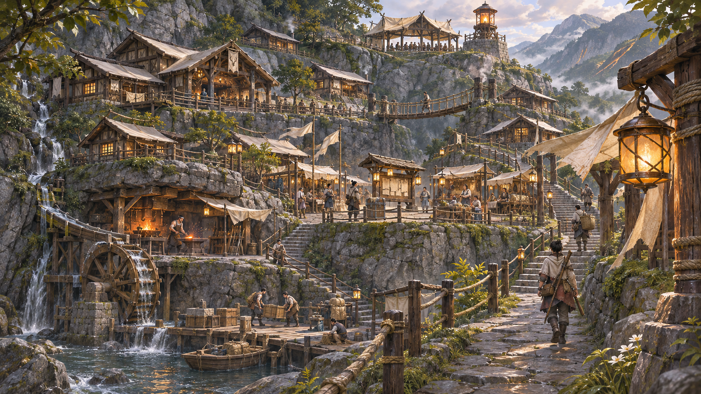

# 灯継ぎの里 — 高低差と暮らしのある拠点設計

ユーザー依頼「拠点は高低差があり、没入感たっぷりの設計とデザイン」に対する設計・原画の提出です。五段の集落を歩き、上下の眺め・仕事・水音・灯を感じる拠点を提案します。

**これは設計と制作資料のPRです。ゲームへの採用・実装は未完了です。** 原資料の参照版はv0.22.0、今回の提出前確認はv0.26.0（`1e078bfce1e68f287ae577cf41d2fe5bafb94afa`）です。現在のNPC・会話・里納品等は[最新実装への追補](latest_state_addendum_v026.md)を優先してください。

## 1. 設計の中心

| 区画の仮称 | 中央広場からの相対床高 | 置くもの |
| --- | ---: | --- |
| 水音の庭 | -10m | 沢、水車1基、荷揚げ場、資材庫、洗い場 |
| 炉の段 | -3m | 工房、半屋外の作業場、材料置場 |
| 灯の広場 | 0m | 依頼板、商店、装備箱、帰還地点 |
| 暮らしの段 | +8m | 狩人の宿、住居、小さな畑、縁側 |
| 灯見の台 | +22m | 集会所、調査机、見張りの灯、回廊 |

歩行床の総高低差は32m、初期試作の外形目安は約120×110mです。いずれも提案値で、現行地形の計測値ではありません。里の名称は既存のものを継承し、五つの区画名は今回の仮称です。

毎回使う四施設を0mと隣接する-3mにまとめます。通常の受注を最高段へ移さず、「一覧」からの直接利用も保ちます。広い石段と折り返し坂の「生活の道」、縁側・岩棚・短い橋をつなぐ「見晴らしの道」を回遊路として設計し、歩いた広場を別の高さから見返せる構成にします。

## 2. 返したもの

| ファイル | 内容 |
| --- | --- |
| [hub_design_v1.md](hub_design_v1.md) | 五段構成、施設、動線、寸法、造形をまとめた設計 |
| [immersion_design_v1.md](immersion_design_v1.md) | 音・光・生活動作・帰還・時間帯・進行による変化 |
| [implementation_handoff_v1.md](implementation_handoff_v1.md) | P0/P1/P2、技術差分、受け入れ条件 |
| [latest_state_addendum_v026.md](latest_state_addendum_v026.md) | v0.26の既存機能・NPC・保存・床高対応の追補 |
| [source_audit_v1.md](source_audit_v1.md) | 原資料と最新監査の固定参照先 |
| [art_direction_v1.md](art_direction_v1.md) | 原画の使い方、素材・色・構造・四視点 |
| [asset_manifest_v1.json](asset_manifest_v1.json) | 画像・図の実寸、形式、バイト数、SHA-256、Git blob SHA |
| [images/](images/) | 全景、中央広場、上層夕景、宿内部のPNG原本4枚 |
| [diagrams/](diagrams/) | 平面・断面PNG原本、再構成した編集用SVG2枚 |
| [report/README.md](report/README.md) | 先に完成した16ページPDFとの対応・版の扱い |
| [report/QA.md](report/QA.md) | 今回の検証範囲、復元の同一性、未検証事項 |

原画4枚はすべて1672×941px・RGB・背景ありです。中央広場は水車の重複を修正した `hub_plaza_eye_v2.png` を採用します。平面PNGは1800×1300px、断面PNGは1800×1180pxです。原画は3Dモデル・完成アニメーション・透過素材・繰り返しテクスチャではありません。

## 3. 守れなかった決まり・迷って決めたこと

- 掲示板に今回の番号付き依頼がないため、ユーザーからの直接依頼として `user-20261125-hub-design` を使いました。変更はこの提出フォルダー内だけです。
- 頻繁な用事の移動を抑えるため、主要施設を中段周辺に置きました。32mの高低差は水辺・住居・展望と散策で強く体験させます。
- 初期の歩行床は同一XZで重ならない構成を優先します。橋の上下をともに歩く機能と乗用昇降機はP2で検討します。
- 原画の背景人物は生活と縮尺の参考です。採用済みのミナギ・ロクハ・イサネの原画を置き換えるものではありません。
- 原画間の建物配置・細部は完全には一致しません。相対標高、接続、施設の役割は設計文書と図を優先し、建物の四方向図は別途確定してください。
- 前回中断後に元の作業用文書とSVGソースを復旧できなかったため、Markdownは完成済みPDFから再構成し、編集用SVGは原PNGを参照して作り直しました。原画4枚・図PNG2枚・配布済みPDFは保存時のSHA-256と一致する原本です。再構成ファイルを失われた旧ソースと同一バイトとは扱いません。

## 4. 確かめたこと・確かめていないこと

Node.js v24.22.3で `npm ci --no-audit --no-fund` が成功しました（50 packages）。原画像と図の形式・寸法・ハッシュ、設計値の一貫性、文書の参照先、差分の配置範囲を確認しています。根拠と詳しい範囲は[QA](report/QA.md)を参照してください。モンスターJSONは含まないため、bestiary取り込み検査の対象はありません。

**未検証**：新地形のプレイ、実際の経路長と準備時間、階段・橋・庇のカメラ、施設の高さ判定、住民の生活動作、昼夜・天候、実機の描画性能。資料の完成をゲーム実装の完了とは扱いません。

## 5. Claudeへ

1. [最新実装への追補](latest_state_addendum_v026.md)を読み、四施設のID・役割とNPC3人、依頼板の物語・会話・里納品D09、工房の支給を維持してください。保存schema4の `claims` と `progress.questClears` を保ちます。
2. P0として中央広場と工房の高低差、階段・踊り場、四施設、NPC、接地・当たり・カメラを試作してください。負の床高を扱うか全体を+10mずらすかを決め、全要素へ同じ座標基準を適用します。
3. P1で五段と二つの回遊路、宿・集会所・水車・荷揚げ設備の外観を追加し、場所に合う短い仕事と音を検討してください。
4. P2で室内、昼夜、進行に伴う小さな景観変化、必要な場合のみ橋の上下通行を対応してください。
5. [引き継ぎの受け入れ項目](implementation_handoff_v1.md)を実装後に検証し、採用時に正式な配置先へ移してください。

担当・変更範囲は[AGENTS.md](https://github.com/kamamon/Kari/blob/1e078bfce1e68f287ae577cf41d2fe5bafb94afa/AGENTS.md)、提出方法は[chatgpt-inbox/README.md](https://github.com/kamamon/Kari/blob/1e078bfce1e68f287ae577cf41d2fe5bafb94afa/chatgpt-inbox/README.md)に従います。
