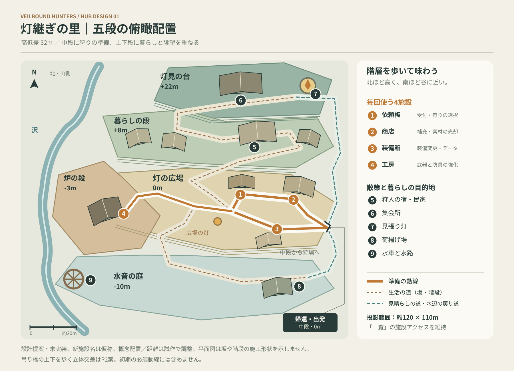
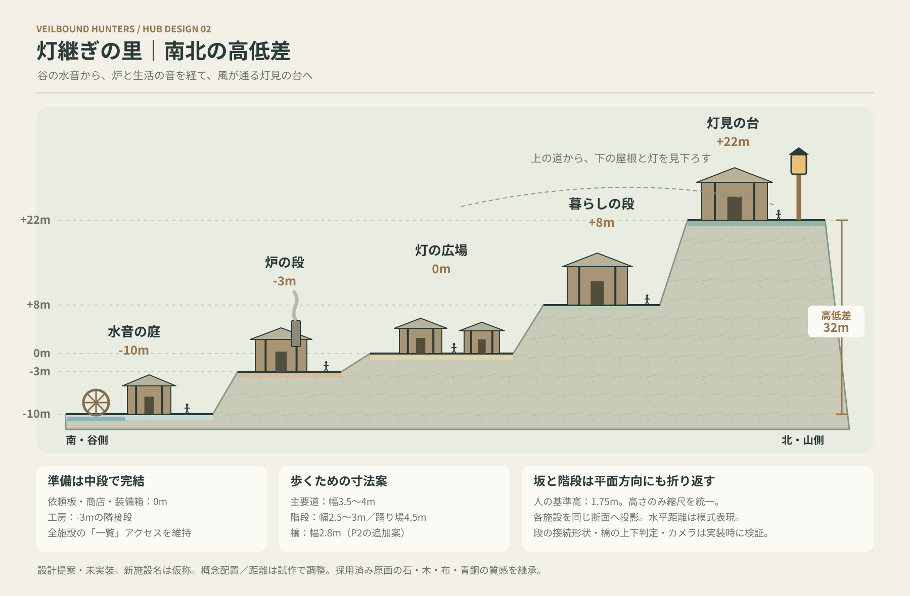

# 灯継ぎの里 — 高低差のある拠点設計 v1

設計日：2026-11-25 JST。状態：**設計・原画提案。新しい地形・建物・演出の実装と採用は未完了。**

この文書は、完成済みの別添 `Kari_Hub_Design_v1.pdf`（16頁）から設計内容を再構成したものです。失われた旧Markdownと同一のファイルではありません。PDFの既存仕様監査は v0.22.0 / `4851d57ecc24c8fd127508b084999cec5d0e975f` 時点です。提出時の v0.26.0 の実装状態は、[最新状態の追補](latest_state_addendum_v026.md)を優先してください。

## 1. 目指す体験

霧の谷の岩棚に、水辺、工房、広場、住居、展望の五段が積み重なる里をつくる。中央広場からは下段の作業と上段の暮らしを見渡せ、坂を上がると先ほど歩いた屋根や灯が眼下に現れる。外から帰るたびに、灯と仕事の続く場所へ戻ったと感じられる拠点を目指す。

日常の準備は中段周辺に集める。高低差は散策、眺望、音と光の変化で味わえるようにし、通常の受注のために毎回最高段まで登る構成にはしない。既存の「一覧」から施設を直接利用する導線も維持する。

引き継ぐのは、里の名称、主要4施設の機能とID、装備変更の即時外観反映、持ち物と保存の仕組み。v0.26.0ではNPC3人、序章・第1章の会話、工房支給、里納品D09も実装済みであり、これらを新配置へ引き継ぐ。詳細は[追補](latest_state_addendum_v026.md)を参照する。

## 2. 五段の配置と高さ

初期試作の外形目安は **120×110m**。中央広場の床を0mとし、歩ける床の最低−10mから最高+22mまでの高低差を **32m** とする。海抜ではなく設計上の相対高で、屋根・塔・遠景の高さは32mに含めない。現行の48×34mの平坦な拠点からの拡張案であり、実装済みの規模や実測値ではない。

| 層 | 区画の仮称 | 相対床高 | 主な施設・活動 | 体験の狙い |
| --- | --- | ---: | --- | --- |
| L0 | 水音の庭 | −10m | 小さな荷揚げ場、水車、資材庫、洗い場 | 水と物資が里を支える様子が分かる |
| L1 | 炉の段 | −3m | 工房、材料置場、半屋外の作業場 | 広場から炉の光と仕事を見下ろせる |
| L2 | 灯の広場 | 0m | 依頼板、商店、装備箱、帰還地点 | 狩りの準備がまとまる里の中心 |
| L3 | 暮らしの段 | +8m | 狩人の宿、住居、小さな畑、縁側 | 賑わいを見下ろす静かな生活域 |
| L4 | 灯見の台 | +22m | 集会所、調査机、見張りの灯、回廊 | 通ってきた里と次の狩場を一緒に望む |

五つの区画名は今回の仮称。里の正式名称「灯継ぎの里」は継続する。概念図は高さと接続の意図を示すもので、道路延長、当たり判定、実機操作を確定する施工図ではない。

## 3. 日常の動線と回遊

基本の準備順は、**帰還 → 装備箱 → 商店・工房 → 依頼板 → 出発**。装備箱、商店、依頼板は0mの広場へ集め、工房はすぐ隣の−3mの段へ置く。工房を使わない回は広場だけで用事を済ませられる。帰還直後に装備箱と進行方向が見えるよう、出入口、庇、岩の重なりを調整する。

| 準備動線の目標 | 経路長の試作目標 | 歩行の理論下限 |
| --- | ---: | ---: |
| 工房を除く一巡 | 45〜65m | 約11〜16秒 |
| 工房を含む一巡 | 75〜100m | 約19〜25秒 |

時間は v0.22.0 の歩行速度4.0m/sによる机上計算。加減速、階段、曲がり角、会話、メニュー操作を除き、実測した準備時間や図から測った道路延長ではない。[歩行の参照データ](https://github.com/kamamon/Kari/blob/4851d57ecc24c8fd127508b084999cec5d0e975f/public/data/player.json)

回遊路は次の二つを軸にする。

- **生活の道**：幅のある石段と折り返し坂で、広場、工房、水辺をつなぐ。次の踊り場や灯が一つ先まで見え、荷物と人の移動が読み取れる。
- **見晴らしの道**：住居の縁側、岩棚の回廊、短い吊り橋を通り、別の経路で中段へ戻る。上層の景色を見た後も里の中心へ戻れる構成とする。

初期段階は歩行床が同じXZで重ならないようにし、橋の下は通行しない場所として扱える。橋の上と下の両方を歩ける構造はP2の拡張で検討する。

## 4. 身体とカメラに合わせた寸法

| 部位 | 初期試作値 |
| --- | ---: |
| 主経路の有効幅 | 3.5〜4.0m |
| 常用階段の有効幅 | 2.5〜3.0m |
| 大きな踊り場 | 幅4.5m以上 |
| 橋の有効幅 | 約2.8m |
| 階段の蹴上げ | 0.15〜0.18m |
| 階段の踏面 | 0.28〜0.32m |
| 荷車用の坂の勾配 | 8〜10% |
| 安全柵の高さ | 1.0〜1.1m |

3mを勾配8〜10%で上る坂には、水平延長約30〜37.5mが必要になる。図の短い接続線を、そのまま短く急な坂として実装しない。階段の見た目と実際の歩行面の扱いは、接地とカメラを試してから確定する。

寸法の検討では、ハンターの身長1.75m・半径0.38m、カメラ距離5.2m・縦FOV58°を参照した。ゲーム環境の試作案であり、実在建築の基準への適合を示す値ではない。[ハンター](https://github.com/kamamon/Kari/blob/4851d57ecc24c8fd127508b084999cec5d0e975f/public/data/player.json) / [カメラ](https://github.com/kamamon/Kari/blob/4851d57ecc24c8fd127508b084999cec5d0e975f/src/render/camera.ts)

## 5. 主要4施設

| 既存ID | 設計上の段 | 外観と立ち位置 | 引き継ぐ機能 |
| --- | --- | --- | --- |
| `workshop` | 炉の段 −3m | 石の炉、暗い木組み、半屋外の作業場。広場から炉の光と作業が見える | 武器・防具の強化、v0.26.0の工房支給 |
| `shop` | 灯の広場 0m | 木の台、棚、樽、布の日よけ、低い灯具。利用者の表側と荷物の裏側を分ける | 道具購入・素材売却 |
| `board` / `kind: quest` | 灯の広場 0m | 二本の柱と小屋根を残し、横に小さな記録台。紙、紐、封印、板の摩耗を見せる | 依頼・訓練場、物語・帰還記録・会話、D09納品 |
| `chest` | 灯の広場 0m | 帰還地点に近い庇付きの箱と武器立て。停止位置と背後のカメラ空間を確保 | 装備変更・持ち物・データ |

工房は未加工材を奥、冷却槽を側面へ置く。煙突は住宅の布屋根直下を避け、炉の近くは石・板・瓦系の屋根とし、布の日よけを離す。商店の荷箱や商品は歩く範囲へ散らしすぎない。採用済みのくすんだ赤系の縞布と新原画の生成り布の最終的な統一は、採用時に選ぶ。

NPCのミナギ、ロクハ、イサネは既存の原画と担当を継承し、担当施設と一緒に移設する。原画の背景人物で置き換えない。既存NPCの実装状態と移設時の注意は[追補](latest_state_addendum_v026.md)を参照する。

宿に別の装備箱を設ける場合も、同じ持ち物と装備を参照する案とする。新たに所有物を別倉庫へ分割するルールは設けない。現在の施設IDと機能は[既存拠点データ](https://github.com/kamamon/Kari/blob/1e078bfce1e68f287ae577cf41d2fe5bafb94afa/public/data/hub.json)を基準に保つ。

## 6. 散策先となる建物

**狩人の宿（+8m）**には寝床、装備棚、机、手袋、外套、古い箱を置く。窓と縁側からは、屋外で歩いてきた同じ広場の屋根と沢を見下ろせる。記念品を足す余地は持たせるが、収納課金や休息義務は定めない。

**集会所（+22m）**は岩棚上の低い木造建物と開いた庇で構成する。地図机、資料、住民の席を主役にし、会話の後に窓の外の里へ目が向く場所にする。通常の依頼受付は中段へ残す。

食堂、調査棚、見張りの灯は生活と調査の目的地として拡張する候補。料理の強化効果、物語の章、営業時間、利用回数、開放条件は、この外観案だけでは決めない。

## 7. 素材と景観の共通規則

石で支え、木で組み、布で覆う。石積みの擁壁と基礎は、上の床を支える構造が見える形にする。木は梁、柱、手すり、橋に使い、継ぎ目と補修跡を用途に合わせる。布は日よけと一部の屋根に使い、炉から離す。青銅の灯具と里の灯を目印にし、霧、岩、暗い木の落ち着いた色の中へ暖色を置く。

里全体の大きな目印は灯、位置を知る補助は工房の煙と沢。水は一筋と小滝へ集中させ、工房、洗い場、畑の用途につなぐ。水車は低層の製材・製粉などの仕事に結び付け、荷揚げ設備は工房への資材輸送として見せる。清水の樋と作業用の水路を分け、排水を飲み水へ戻さない。

採用基準は[アート基準ボードv2](https://github.com/kamamon/Kari/blob/4851d57ecc24c8fd127508b084999cec5d0e975f/art-source/board/style_board_v2.png)と[景観依頼8](https://github.com/kamamon/Kari/blob/4851d57ecc24c8fd127508b084999cec5d0e975f/docs/chatgpt-request-8.txt)。夕景原画は昼用素材を自動的に置き換える指示ではない。

制作単位は、岩棚・擁壁、石段・踊り場、デッキ・手すり、橋、灯具、庇、主要4施設、宿・集会所、水路・水車、生活小物に分ける。原画は材質と雰囲気の指針であり、建物の正面・背面・両側面・平面、部材寸法は別途確定する。

## 8. 原画の扱いと実装への引き継ぎ

| 原画 | 用途 |
| --- | --- |
| [全景](images/hub_panorama_v1.png) | 五段の重なり、里の輪郭、水と灯の位置 |
| [中央広場](images/hub_plaza_eye_v2.png) | 歩行視点、主要施設と上下の生活の重なり |
| [上層夕景](images/hub_overlook_dusk_v1.png) | 上から見下ろす里、冷たい霧と暖かい灯 |
| [宿内部](images/hub_lodge_interior_v1.png) | 室内の暮らしと外の広場のつながり |

原画4枚は背景込みの制作資料で、3Dモデル、完成したアニメーション、透過切り抜き、繰り返しテクスチャではない。画像間にある細部や配置の差は、設計図と実際の歩行検証を優先して整理する。

生活・音・光と帰還の詳細は[没入感の設計](immersion_design_v1.md)、制作順序・技術差分・受入条件は[実装引き継ぎ](implementation_handoff_v1.md)に分けている。新地形のプレイ、施設接続、生活動作、昼夜、橋上下、実機性能、建物四方向の整合は未検証。完成した設計資料と、遊べる拠点の完成を区別する。
