# モンスター解剖構造・骨格・動作の詳細設計 v2 — PDF復旧版

> 2026年11月25日に納品した43ページのPDFから、全文を復旧した資料です。元のMarkdownファイルそのものではありません。見出し・表・段落をPDFの配置から再構成し、全43ページの本文・表・注記を保持しています。技術図はPDFから抽出し、原画の再掲レイアウトは同じ既存原画への参照に置き換えています。本文中の現行実装の記述は、原本の基準であるKari v0.22.0時点のままです。現在との差分は別紙で扱ってください。

- 原本: `Kari_Monster_Anatomy_Design_v2.pdf`（43ページ）
- 原本の保存版SHA-256: `8048bab494116d51cd624b89fd971601e0d978ffe605e5edf99b8562ed881ce2`
- 印刷表の座標精度: 0.001m。元の設計JSONの全精度、socketの全定義、局所軸やbind matrixを復元したものではありません。
- 本文中の別添ファイル名と当時の検証結果は原本の記述です。今回復旧して提出するファイル構成と最新実装との差分は、この提出のREADMEを参照してください。
- 技術図7点はPDF内の画像を抽出しています。ガルドロスの原画再掲2レイアウトと、ほか12種の原画は、同じ原画を収めた既存リポジトリ内PNGを参照します。再掲レイアウト自体を新規原画として提出していません。

## 原PDF 01ページ — 生物として成立するモンスターへ

*0 1  /  B R I E F*

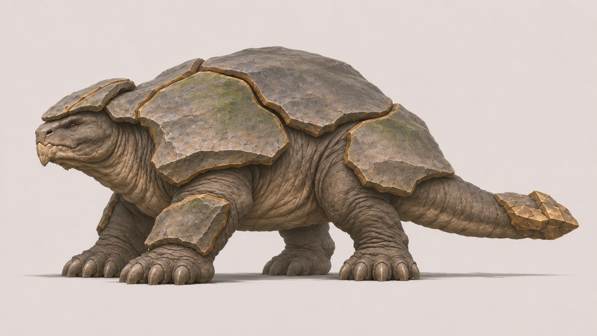

採用済みガルドロス設定図を参照。新たな完成モデルの画像ではない。

**Kari モンスターデザイン・骨格・変形・動作 詳細設計 v2**

身体の厚み、関節の位置、支える脚、動く器官を一つの設計として扱う。皮膚は連続して伸び縮みし、岩板や甲殻は硬さを保つ。攻撃を始める前の荷重移動と、終わった後の立て直しまで作る。

| 対象 | この設計書で決めること |
| --- | --- |
| 基準モデル | ガルドロスの79ノード案、パーツの接合、関節の役割、接地、既存技との対応 |
| 展開対象 | 主要13種と幼体8種の固有構造。残る65種は体型と必須器官の制作台帳 |
| 表面の設計 | 連続した皮膚、剛体の殻、膜、口・眼の材質と変形を分ける |
| 実装への引き継ぎ | 既存の技時刻・ID・寸法を維持する契約、優先順、受入条件 |

**基準ソース:** kamamon/Kari v0.22.0 / 4851d57ecc24c8fd127508b084999cec5d0e975f。2026年11月25日。

**成果物は詳細設計資料。** 正式GLB、Blenderファイル、完成アニメーション、ゲームへの組み込みを納品したものではない。骨数・可動域・LOD・許容誤差は、明記した現行値以外すべて初期提案値。ガルドロス以外の原画は採用待ちの状態を維持する。

*原PDFフッター: KARI / MONSTER ANATOMY DESIGN v2 / 1*

---

## 原PDF 02ページ — 現在できていることと、残っていること

*0 2  /  CU R R E N T  STAT E*

現行コードはすでに骨付きの連続メッシュを使っている。改善の主眼は、骨の役割と変形・接地・判定の関係を完成させることに置く。以下はソース確認結果で、実機映像を観察した診断ではない。[R1][R2][R3]

| 項目 | v0.22.0で確認 | 今回の設計 |
| --- | --- | --- |
| ガルドロス | 53骨。顎、舌、左右瞼、尾8節、独立岩板15枚、足先保持と2節IK | 基盤を残し肩甲部・ねじり・指・胸郭を補う |
| 大型11種＋幼体8種 | 19〜50骨。横原画から生成する仮モデル | 正面の幅と関節位置を含む立体の設計へ |
| 一般リグの顎 | Pose.jawの値はあるが顎骨と適用経路がない | 独立下顎、口腔、ヒンジを設ける |
| 一般リグの歩行 | 移動距離に連動したsin/cos歩容 | 支持足を地面に保持し、体側で届く範囲を調整 |
| 翼と足指 | 翼は片側1骨。指は足先骨に固定 | 翼の肩・肘・手首、趾の離地を分ける |
| 攻撃を与える形 | 173軌道を部位マーカーから焼き込む仕組みあり | この工程を維持し、新リグと動的補正を照合 |
| 攻撃を受ける部位 | 本体の位置・向きだけで固定形状を変換 | 首・脚・尾などの確定姿勢へ追従 |
| 表面 | 一般モデルは基本材質＋眼・発光。色原画を凹凸にも使用 | 専用UV、normal、roughnessと材質の境界を設計 |

**修正済み:** チルミカナの幼燐節2件、ユルテピカの紡糸管2件、キリサーヴの左右2対の可動ひれ足を確認。前回PR #6の未修正項目として再掲しない。

**全86種の状態:** implemented 20（大型12＋幼体8）、art 1（エンバルグ）、planned 65。技定義は一般19種で256件、ガルドロスは23件。咆哮や退避も含むので「279種類の打撃攻撃」とは呼ばない。

PR #6はv0.20.0を基準にした先行提案。本書は現行への差分を反映し、解剖構造と制作仕様を具体化した追補である。[R4]

*原PDFフッター: KARI / MONSTER ANATOMY DESIGN v2 / 2*

---

## 原PDF 03ページ — 骨・筋肉の量感・皮膚・硬殻を分ける

*0 3  /  ST R U CT U R E*

実在生物から参照するのは、関節の向き、荷重経路、硬い部分と柔らかい部分の接合である。晶脈や共鳴嚢などは架空の器官として設計し、実在する解剖学と混同しない。

| 層 | 形と役割 | 動かし方 |
| --- | --- | --- |
| 骨格 | 胸郭、骨盤、肩、肘、膝、顎、尾の支柱 | 階層の関節変換。殻の大きさで関節の支点をずらさない |
| 筋肉の量感 | 肩の盛上がり、臀部、首の付根、腹壁 | スキンウェイトと補助骨。強い曲げのみ補正形状を使う |
| 皮膚・関節膜 | 胴・脇・股・首の連続する表面 | 関節の内側は畳み、外側は張る。体積をできるだけ保つ |
| 硬殻・爪・角 | 岩板、甲殻、骨環、鋏、爪の先 | 形を保って移動・回転。柔らかい継ぎ目で相対運動を許す |

**作る順序:** 無地の身体で正面・横・上の量感を決める → 関節の最大姿勢を通す → 殻・器官を取り付ける → 材質を付ける。肌テクスチャで形の不足を隠す工程にしない。

全筋肉の物理シミュレーションは前提にしない。肩や肘の潰れを補う少数の補正形状と、胸腹の呼吸でまず成立させる。甲殻の下へ隠した皮膚は、可動時に隙間から見える範囲も用意する。

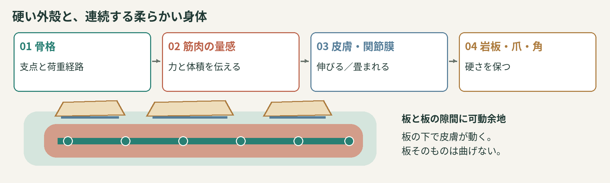

構造模式図。各層の厚さや色は説明用で、組織の実測ではない。

*原PDFフッター: KARI / MONSTER ANATOMY DESIGN v2 / 3*

---

## 原PDF 04ページ — 横原画から、厚みのある立体へ

*0 4  /  V O LU M E*

ガルドロスは採用された四方向図を基準とし、左右の非対称を維持する。左肩は大きな板、右肩は中小の板、左の前脚甲・腰板が大きい。晶の筋を全身に増殖させず、岩の縁と尾端を主役にする。[R5]

| 固定・照合する寸法 | 扱い |
| --- | --- |
| ゲーム内全長 約5.8m | 現行リグの基準。図鑑の8.5mをそのまま倍率に使わない |
| 設定図換算の全高 約2.45m／全幅 約3.2m | 殻を含む図面上の目安。ゲームの実測寸法とは区別 |
| 腹下 約0.7m／足外幅 約2.7m | 立ち姿で確認する輪郭基準。動作時の接地は別途検証 |
| 左右・上下の向き | m単位、Y上、+Z前、+Xが個体左側、-Xが個体右側 |

**必要な断面:** 首根元、胸、腹、骨盤、尾根元の5か所。胸は背側の殻を支える広い断面、腹は下へ柔らかく落ち、尾根元は後脚より内側からつながる。すべて同じ楕円を連ねない。

**不足図の具体的な指定:** ガルドロスは真横の左側面、上面、足裏・趾の配置、最大開口、肩と殻の接合、頭冠／背殻／尾の破壊後。ほかの12原画は正面・背面・左右・上面の縮尺をそろえる。透視図から見えない横幅を推定した箇所は「仮」と記す。

各図で肩・肘・手根・股・膝・足根の位置に共通の印を付ける。関節を絵ごとに動かさず、同じ骨格から投影する。図面が整合してからモデリングへ進む。

ガルドロス採用済み四方向原画: [正面](../../art-source/monster/galdros/galdros_front_v1.png) / [背面](../../art-source/monster/galdros/galdros_back_v1.png) / [左側面](../../art-source/monster/galdros/galdros_left_v1.png) / [右側面](../../art-source/monster/galdros/galdros_right_v1.png)

採用済み四方向資料。左側面は少し斜めで、厳密な正投影ではない。

*原PDFフッター: KARI / MONSTER ANATOMY DESIGN v2 / 4*

---

## 原PDF 05ページ — ガルドロスの79ノード設計

*0 5  /  H E R O  R I G*

既存53骨の役割と寸法を土台にする。79はrootを含む設計ノード数で、操作用コントローラーとsocketは含めない。すべての生物の骨を再現する数ではない。

| 構成 | 数 | 追加する意味 |
| --- | --- | --- |
| root・胴・腰・胸・左右肋部・首・頭・顎・舌2節・眼2・瞼2 | 18 | 胸腹の左右、視線、開口を独立させる |
| 尾 | 8 | 現行の節と切断関係を維持 |
| 前脚（左右各11） | 22 | 肩甲・上腕・前腕・ねじり補助・手根・掌・趾制御5 |
| 後脚（左右各8） | 16 | 大腿・下腿・ねじり補助・足根・中足・趾3群 |
| 岩板 | 15 | 現行の独立板を維持。材質単位にまとめて描ける |
| 合計 | 79 | 53から26ノード増。実機計測で採否を決める |

肩甲部は胸の子、上腕は肩甲部の子。前腕のねじり骨は補助の枝とし、手根の親をねじり骨へ変えてIKの脚長を増やさない。後脚も同様に、下腿からねじり補助と足根を分岐する。

前脚の5制御は現行造形の4前趾と後方のけづめに対応する案。後脚の3群は内側・中央・外側の制御領域であり、実趾数を3本へ変更する意味ではない。最終配置は足の設定図で確定する。

別添の galdros_rig_blueprint_v2.json に全ノードの親、actor座標、既存番号との対応、推定箇所を記載する。**実行用データや完成したbind poseではない。** 現行Bone.nameは空のため、新名は対応表による採用が必要。

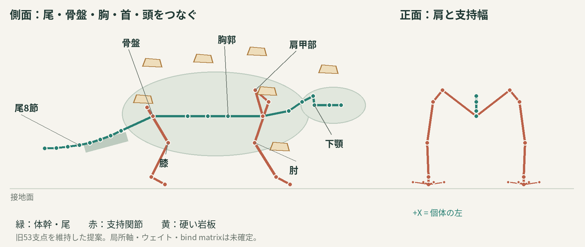

骨格の役割と接続を示す模式図。新たなGLBのスクリーンショットではない。

*原PDFフッター: KARI / MONSTER ANATOMY DESIGN v2 / 5*

---

## 原PDF 06ページ — 関節は、曲がる方向と限界まで決める

*0 6  /  J O I N TS*

以下はガルドロスを初期ポーズ調整するための**制作上の提案値**。実在動物の医学的可動域ではなく、自然立ちからの相対変化を表す。書き出し時のbone rollを確定した後、ローカル軸へ変換する。

| 部位 | 初期の範囲案 | 制約と見た目 |
| --- | --- | --- |
| 肩甲部 | 前後滑走 ±0.06m、回転 ±12° | 胸郭表面に沿う。前脚を上げても肩が球ごと抜けない |
| 前脚付根 | 前後 -35〜+70°、外転 -12〜+18° | 動かす側の背殻へ衝突しない範囲で調整 |
| 肘 | 基準から屈曲 -15〜+75°、横曲げ ±5° | 主に1方向の折れ。伸び切りでIKを反転させない |
| 手根・掌 | 前後 -20〜+30°、左右 ±10° | 掌から趾へ接触を移して離地する |
| 前趾 | 屈曲 -10〜+35°、開き ±6° | 岩を掘る時だけ強める。爪自体は曲げない |
| 股・膝 | 股 -45〜+55°、膝 -15〜+80° | 膝は前へ、踵に当たる足根は後ろへ折れる構造 |
| 首2節 | 1節当たり上下 ±12°、左右 ±18° | 頭を向ける時に首根元から分担。頭だけ回さない |
| 顎 | 閉口0〜開口32° | 顎関節を後方に置き、歯・嘴・舌を貫通させない |
| 尾 | 根元側左右 ±12°、先側 ±18°/節 | 角度を全節同時に最大にしない。切断後を別検査 |
| 岩板 | 通常の微動0〜1.5°、根元の移動0〜5mm | ばたつく鎧にしない。壊れるまでは板を変形させない |

表の最大角度を同時に使ってよい、という意味ではない。肩と殻、首と頭冠、尾と後脚の衝突を組合せで制限する。関節の角度だけで通過判定せず、最大屈曲・開口・振り向き・転倒の形も見る。

**ウェイト:** 1頂点最大4影響をKariの互換性方針とする。重みは正規化。硬板は原則1本に固定し、皮膚は関節の前後へ連続的に配る。glTF自体の絶対上限が4という意味ではない。[E1]

*原PDFフッター: KARI / MONSTER ANATOMY DESIGN v2 / 6*

---

## 原PDF 07ページ — 肩・腹・口・殻の接合を作り込む

*0 7  /  D E F O R M AT I O N*

**関節を別々の球や筒として露出させない。** 内部の構造は分かれていても、外側の皮膚は肩から胸、股から腹へ連続させる。岩板の下には、重さを受ける皮下の晶脈床と厚い皮を設計する。

| 部位 | メッシュとウェイト | 補正・確認する姿勢 |
| --- | --- | --- |
| 肩・脇 | 肩甲・上腕・胸でなめらかに分担。脇に内向きの折れ目 | 前脚挙上で胸に穴が開かず、肩の量感が残る |
| 肘・膝 | 曲げ部の前後に補助ループ。外側を丸く、内側を畳む | 曲げ切りでパイプのようにつぶれない |
| 腹・胸郭 | 左右肋部と腹側を弱く分担。背殻は呼吸へ巻き込まない | 呼吸で体全体が風船状に膨らまない |
| 首・顎 | 下顎、口腔壁、舌、歯列／嘴を分ける。口角は連続皮膚 | 最大開口、横向き、閉口で内部の裏面が見えない |
| 尾の付根 | 骨盤からの太い筋肉の連続。尾先ほど細く | 横払い、持上げ、切断後でも断面が開かない |
| 岩板の縁 | 硬い表板＋厚み＋下面。付根に短い可動皮膚 | 板と皮の間に真っ暗な空洞や浮いた線が出ない |

補正形状の候補は shoulder_raise、elbow_compress、neck_extend、jaw_open、flank_breathe。同じ変形を補助骨とモーフの両方で二重に加えない。顎32°や前脚最大挙上など、補正を作った姿勢を一緒に納品する。

前脚叩きの荷重では、掌と胸が少し沈み、皮膚が広がる。岩板は後からごく小さく収束する。殻を軟らかく曲げて衝撃を表現しない。質量と粘りを見せる微動は、打撃判定の位置を勝手に変えない範囲に留める。

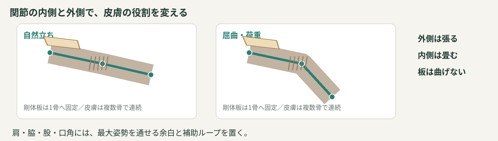

連続皮膚の変形、剛体板、関節膜の関係。量と厚さは制作提案。

*原PDFフッター: KARI / MONSTER ANATOMY DESIGN v2 / 7*

---

## 原PDF 08ページ — 接地は足ごとの状態として管理する

*0 8  /  CO N TA CT*

足には swing（空中）、touchdown（接触へ移る）、stance（支持）、toe_off（離地） の4状態を設ける。支持中の位置を保持し、本体の移動に合わせて足を毎フレーム引きずらない。

| 状態 | 足と身体の処理 | 例外・遷移 |
| --- | --- | --- |
| swing | 前回の離地点から次の接地点へ弧を描く。趾を軽く畳む | 障害物や歩幅不足なら接地点を再計画 |
| touchdown | 地面の高さ・法線に合わせ、掌→趾へ接触を広げる | 接触イベントは1回だけ。空振りなら支持にしない |
| stance | 足先をワールド座標に保持。胸・骨盤と脚IKで合わせる | 動く床なら床のローカル座標で保持 |
| toe_off | 荷重を抜き、掌を上げ、趾を最後に離す | 明示した滑走・掘り・突進の蹴り出しは別モード |

**低速歩行案:** 左後→左前→右後→右前の4拍。各遊脚は周期の約20%、開始は0/25/50/75%。低速の支持率は約80%を出発点にし、3〜4脚で支える。速度を上げると別の対角歩容へ移行する。これはガルドロス専用の初期設計で、すべての動物に適用しない。

**立ち直りと旋回:** 地面に固定した4足のまま本体だけ回さない。旋回角に合わせて内側の足を先に踏み替え、外側の足で送り出す。足が届かない場合は胸・骨盤を調整し、それでも届かなければ踏み直す。

胸と骨盤の高さは複数の接触点から求める。IKは伸び切り直前に上限を設ける。地形サンプル欠落時は最後の正常な接触を短時間使い、その後は通常歩行へ戻す。テレポートや転倒復帰では古い足アンカーを必ず解除する。

重心投影を支持領域へ収める確認は、待機や低速のために使う。走り・跳躍・転倒では慣性と次の着地を考える。重心マーカーは近似の演出設計であり、生体物理計算の実装を意味しない。

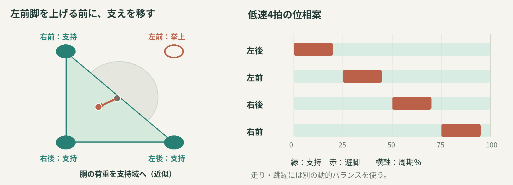

左前脚を上げた時の支持の考え方と、低速4拍の初期位相案。

*原PDFフッター: KARI / MONSTER ANATOMY DESIGN v2 / 8*

---

## 原PDF 09ページ — 前脚叩きつけを、既存120tickで磨く

*0 9  /  E X I ST I N G  A CT I O N*

対象は monster.galdros.slam_l / slam_r。**0〜48予備、48〜54攻撃、54〜120回復**という既存区間を保つ。1tick=1/60秒。[48,54) は48〜53tick。照準旋回は28tick未満まで。[R6]

| tick | 身体・支持・器官の設計 | 実装上の照合 |
| --- | --- | --- |
| 0〜18 | 支持側の前脚と両後脚へ胸を寄せる。上げる足の荷重を抜く | 根元の向きと支持アンカーを一致させる |
| 18〜30 | 肩甲部→上腕→肘の順で前脚を上げる。掌は少し閉じる | 28tick以降は照準追従を足さない |
| 30〜48 | 高い前脚と下がった頭冠で、打つ側を明確にする | 46tickの振り音。攻撃軌道へ自然につなぐ |
| 48〜54 | 胸の前下方への力を、前腕・掌へ伝える | 判定と打撃面を全tick照合。53tickの既存VFXを維持 |
| 54〜78 | 掌、肩、胸が沈む。岩板は遅れて小さく収束 | 活性の終端と衝撃演出を混同しない |
| 78〜104 | 4脚支持へ戻す。掌が戻る前に待機歩行を重ねない | 足アンカーを適切な時点で再設定 |
| 104〜120 | 呼吸と微小な尾の収束を残して通常姿勢へ | 回復時間を見た目の都合で縮めない |

30/78/104は既存の軌道キーを利用する演出案。48tickが必ず地面へ接触する瞬間とは限らない。打撃面の実位置、軌道、53tickの地面VFXを並べて最終調整する。

突進は190tick、尾払い110tick、噛みつき96tickの現行値を基準にする。突進は後脚で押してから走る、尾払いは骨盤→尾根→尾端の順に加速、噛みつきは首を畳んでから顎を開く。攻撃力・届く距離・受付窓を新設計だけで変更しない。

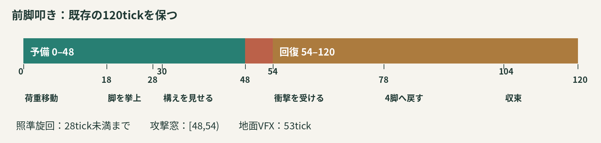

既存の攻撃窓を維持した身体動作の設計。値はpublic/data/actionsと照合。

*原PDFフッター: KARI / MONSTER ANATOMY DESIGN v2 / 9*

---

## 原PDF 10ページ — 戦っていない時間にも身体の理由を作る

*1 0  /  L I F E  &  T R A N S I T I O N S*

モンスターの存在感は、攻撃以外のしぐさでも決まる。すべての部位を同時・同周期で揺らさず、注意が向く順序と器官の役割を見せる。以下は追加演出の設計で、現在の生態AIの完成を示すものではない。

| 状態 | 姿勢・注意の流れ | 身体型への差分 |
| --- | --- | --- |
| 安静 | 胸腹の小さな呼吸、時々の瞬き。頭は足の小さな動揺を相殺 | 甲殻は板全体で呼吸せず、腹節の膜をわずかに動かす |
| 気配に気付く | 目・触角→頭→首→胸→踏み替えの順 | 視線だけ瞬間移動させない。触角のない種へ足さない |
| 採食 | 匂いを確かめ、足で掘り、口へ運び、咀嚼する | ガルドロスは根と地衣、鳥型はくちばし、蟲型は口器 |
| 怒り | 呼吸、支持幅、固有器官の構えを変える | 速度倍率だけで表現せず、帆・嚢・灯節を予告へ使う |
| 負傷 | 痛む部位をかばい、他の脚の支持時間を伸ばす | 全身を一律にゆっくり再生するだけにしない |
| 休眠 | 重い殻を地面や壁に預け、支持を解く | 息は残す。死と同じ完全停止にしない |
| 転倒・起床 | 体側が接触→もがく→支持脚をそろえる→胴を持ち上げる | 再生の終わりだけで戦闘状態へ戻さない |
| 討伐・捕獲 | 討伐は力が抜けて収束。捕獲は呼吸と微動を残す | 攻撃、足固定、イベントの残留を止める |

呼吸の初期案は1周期3〜6秒、胸腹の変形は局所寸法の約0.5〜1.5%。これは微動の目安で、生理学的測定値ではない。戦闘カメラで不自然な膨張が見えない量へ調整する。

姿勢は基本動作へ局所被弾・制限付き視線を加え、支持と身体補正を最終的に解く。支持脚の親へ影響する加算を後段で行う場合は、接地を再投影する。攻撃有効中は接地と採用shapeTrackの制約を一緒に解く。非判定部の微動だけを描画へ追加する。

*原PDFフッター: KARI / MONSTER ANATOMY DESIGN v2 / 10*

---

## 原PDF 11ページ — 材質で、皮・殻・膜・湿りを読み分ける

*1 1  /  M AT E R I A LS*

皮膚、岩殻、薄い膜、眼・口の湿った部分を分ける。ポリゴンを一様に増やすより、輪郭と関節へ面を配り、細部は専用のnormalとroughnessで表す。現在の横投影原画の色を凹凸にも使う方式から、固有UVへ移す。[R2][E1]

| 材質 | 初期roughness案 | 制作指示 |
| --- | --- | --- |
| 乾いた厚皮 | 0.65〜0.9 | 深いしわは形、細かいしわはnormal。肘内側に集中 |
| 岩・硬殻 | 0.75〜0.95 | 欠けた縁と厚みは形。浅い亀裂を色だけで掘らない |
| 爪・嘴・角 | 0.35〜0.6 | 根元から先への成長方向をそろえる |
| 湿った口・眼・泥 | 0.12〜0.35 | 濡れをmetalnessで代用しない。眼のハイライトは小さく |
| 帆・嚢・羽袋 | 0.45〜0.75 | 芯や血管状の構造は控えめ。器官の張りを形で表現 |
| 晶・灯節 | 個別検討 | 発光マスクを限定。常時最大発光で立体を消さない |

数値は照明下で調整する提案値。通常の皮・岩・爪はmetalness 0を起点とする。青銅色であることは、金属であることと同義ではない。意図した金属結晶だけを別判断する。

**画像の役割:** Base Colorには照明の強い陰影を焼き込まない。normalは凸凹の向き、roughnessは反射の広がり、AOは接合部の弱い遮蔽。色・発光はsRGB、normal・roughness等は線形データとして扱う。[E1]

**面の配置:** 肩・脇・股・口角・尾根・翼関節へ優先配分。大岩板の外形や鋏の輪郭はgeometry、細かな傷はtexture。硬い縁には厚さと適切な法線、皮膚には連続した滑らかな法線を使う。

透明な殻や羽の全面に高価な透過を使うことは前提にしない。オルグラスは不透明寄りの面＋縁の反射で試作し、重なる透明面の前後・影・負荷を確認して必要な場所に限定する。

*原PDFフッター: KARI / MONSTER ANATOMY DESIGN v2 / 11*

---

## 原PDF 12ページ — 部位破壊を、構造の変化として作る

*1 2  /  D A M A G E*

部位破壊は、外殻を取り去った後に何が残り、どの動きが変わるかまで決める。現在の一般リグの暗色化・0.82倍縮小は仮表現。正式化では部位別の差し替えへ移す。[R2]

| 部位 | 無傷 | 破壊後に残すもの | 動作・判定との関係 |
| --- | --- | --- | --- |
| ガルドロス頭冠 | 厚い平岩冠 | 不規則な冠の根元、露出した厚皮 | 頭部判定を頭の姿勢へ追従。弱点倍率は既存仕様 |
| 背殻 | 大きな左右板と青銅色の縁 | 割れた板の基部、晶脈床、皮膚 | 背中が空洞にならない。重い板の微動を解除 |
| 前脚甲 | 外側の板 | 欠けた縁と地肌 | 肩・掌の支持運動を保つ |
| 尾 | 太い皮膚の尾＋尾端晶 | 閉じた切断面、残った節 | 既存の切断後技分岐と範囲を維持 |
| 帆・翼 | 張った膜・羽列 | 根元、裂けた縁、短く残る支柱 | 全体を消すだけで肩や頭の構造を露出させない |
| 嚢・灯節 | 器官壁と内部の光 | しぼんだ壁、弱まった発光等 | 機能変化はゲーム仕様として別に照合 |

破片は見た目専用とし、攻撃部位IDと混同しない。同じ破壊イベントを複数描画フレームで発火させない。幼体群れでは、一体の破壊・発光変更が共有materialを通して全個体へ波及しないようにする。[E3]

全LODで切断位置・残る部位・socketの意味をそろえる。ガルドロスの残存側切断面はtail_04から境界へのoffsetで定義し、切断時に無効化されるtail_05から取得しない。切断後の尾打撃は残存側の別socketへ切り替える。遠方LODで無傷へ戻らないことを確認する。断面は厚皮・晶脈床・乾いた鉱質の層で見せる。

*原PDFフッター: KARI / MONSTER ANATOMY DESIGN v2 / 12*

---

## 原PDF 13ページ — 体型別に、支持構造を共通化する

*1 3  /  R I G  FA M I L I E S*

登録簿のframe IDと86種のIDは変更しない。制作上は、多脚甲殻を水平歩行と輪化に分ける。巨躯は、各種の器官がそろってから骨格を確定する別枠とする。[R7]

| 制作テンプレート | 代表 | 支持と関節の核 |
| --- | --- | --- |
| 重い四足 | ガルドロス、ヌメラドン、ボルナケル、エンバルグ | 胸・骨盤、低い腹、広い掌。重い器官の根元を支える |
| 軽い四足 | セルヴァルク、ヴェルガイト | 肩甲の滑走、後肢のばね、細い足先、跳躍後の回収 |
| 二足と短翼 | アシュレイア、ルミスカ | 支持脚・骨盤・長頸、肩→肘→手首→羽列。翼は前肢 |
| 六脚と鋏 | オルグラス | 歩脚6本、左右別の鋏脚。鋏の固定指と可動指 |
| 水平多脚 | ヴェリト | 4対8脚の支持波。羽袋は非飛行器官。胸腹を安定 |
| 輪化多脚 | テンガロ | 体節の連鎖、関節膜、鉤と脚の収納、輪接地点 |
| 長胴と短肢 | ラズメル、キリサーヴ | 胴の接触区間、前後2対の短肢／ひれ足、曲がり伝播 |
| 巨躯 | 計画10種 | カメラ、接触領域、器官、部位攻略を個別に設計 |

同じテンプレートでも、骨長・関節可動域・足の位相・器官の動きを調整する。鳥型へ一般四足の前脚と翼を同時に付けたり、多脚へ昆虫の三脚歩行を一律に強制しない。

次ページからは、主要13種を「骨格」「接合」「移動」「固有動作」「破壊」「必要図」で個別指定する。原画採用待ちの種では、新しい骨の配置や厚みは制作提案としてレビューする。

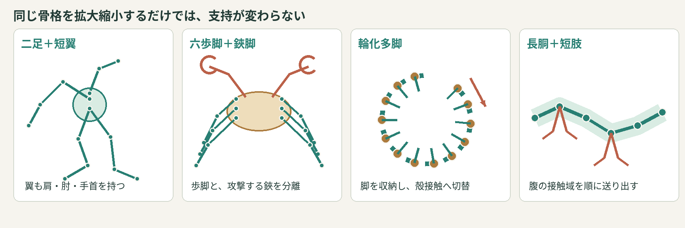

二足と翼、鋏を持つ六脚、輪化、長胴の役割模式図。脚数は各種の設計に従う。

*原PDFフッター: KARI / MONSTER ANATOMY DESIGN v2 / 13*

---

## 原PDF 14ページ — 岩殻獣 ガルドロス

*S P E C I E S  0 1  /  A N ATO M Y*

既存原画を再掲。骨格・接合・動作の記述は今回の制作提案。

monster.galdros / 四足重獣 / 採用済み設定図・仮モデル

1. **保つ輪郭**: 左肩に大板1枚、右肩に中1＋小1、背殻は左右2枚を基準。左前脚甲・左腰板も大きい。頭の平岩冠、太い地肌尾、塊状尾端晶を保つ。晶脈の見た目は採用図の縁取りと尾先を基本にし、全身を光る線で覆わない。

2. **骨格**: 骨盤と胸郭を別の塊にし、間を腰・背骨でつなぐ。左右肩甲→上腕→前腕→手首→中手→指、股関節→大腿→下腿→足首→足指を独立。肩甲の前後滑りに、肩板を必要な分だけ追従させる。親はchestを維持し、限定的なドライバーで肩甲変位を参照する。首は根元と頭寄りを分け、頭冠の重さを首根で受ける。

3. **支持**: 低速時は広い足裏と複数趾で接地し、前脚を上げる前に胸郭を残る3脚側へ寄せる。左背殻の大きさは外見の非対称であり、実際の重心偏り量は重量配分を置いてから決める。左へ常時大きく傾けない。

4. **皮膚と殻**: 胸・腹・腿は連続した厚い皮膚。肘、脇、股、首下は折り目を集め、曲げ外側は伸びる面を確保する。岩板は変形しない剛体部品として皮下の晶脈床に座らせ、根元には厚い皮膚の襟を作る。隣の板は傾いても互いを貫かない。

5. **歩行／旋回**: 一歩を「足先固定→胴が進む→踵または掌底が離れる→指で離地→振り出し→接地」に分ける。方向転換は内側の歩幅を縮め、外側の歩幅を長くし、重い尾を少し遅らせる。四脚を地面に貼り付けたまま胴だけ回転させない。

6. **前脚叩き**: 反対前脚と両後脚へ荷重→胸を少し持ち上げる→肩甲と肘を畳んで攻撃脚を持ち上げる→胸を落とすと同時に肘を伸ばす→掌接触で手首・肘・肩が短く沈む→体重を中央へ戻す。硬い岩板の揺れより、胸の沈みと足裏の停止が先に見えるようにする。

7. **尾払い／突進**: 尾払いは支持脚を踏み替え、骨盤→尾根→中間→尾端の順に加速。尾端晶をただ水平回転させない。突進は首を縮めて頭冠を胸の前へ置き、後脚の押出しと前脚の受けを周期で示す。

8. **追加図と合格像**: 真横の左側面、上面、前脚5趾の足裏、肩甲と板の接合断面、頭冠／背殻破壊、尾切断面。四方向資料では前足の爪5本が記録されているので正式モデルで根拠なく3本へ単純化しない。

*原PDFフッター: KARI / MONSTER ANATOMY DESIGN v2 / 14*

---

## 原PDF 15ページ — 帆角獣 セルヴァルク

*S P E C I E S  0 2  /  A N ATO M Y*

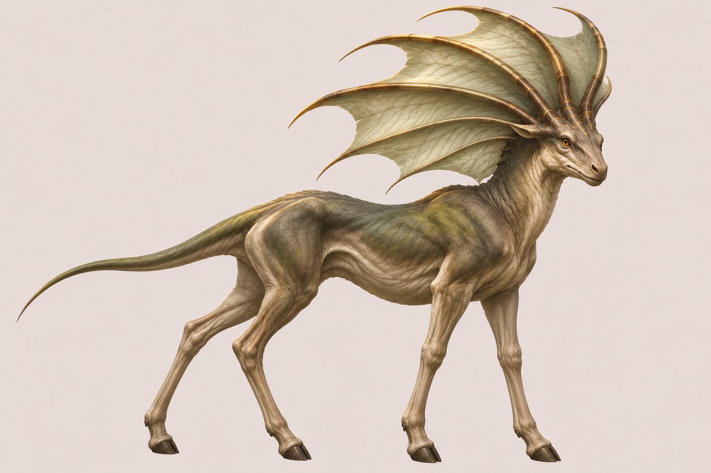

既存原画を再掲。骨格・接合・動作の記述は今回の制作提案。

monster.selvark / 四足軽獣 / 原画採用待ち・仮モデル

1. **保つ輪郭**: 細い後脚と大きな分割帆角膜。帆は頭の器官であり翼ではない。前後脚・割れた蹄の位置を先に固定する。

2. **骨格**: 四足軽獣の胸郭・骨盤、可動肩甲、長い中足部、足首、蹄2葉を分ける。頭の左右に帆角膜の基部骨を置き、各帆を基部・主支持軟骨・外縁の少数レイへ分割する。帆全体を1枚板として回転させるだけの状態から進める。

3. **支持**: 後脚は股→膝→足首→中足→蹄を明示し、後ろへ突き出る関節を逆膝として扱わない。横跳びは踏み切る側の後脚へ骨盤を寄せ、着地予定側へ身体を傾け、蹄先から荷重を受ける。

4. **表皮と帆**: 胴は薄い皮膚と腱の線、帆は根元を厚く、外縁を薄くする。分割の谷に畳み代、支持レイ間に浅い弛みを置く。伸展時に面積が極端に増えず、畳んだ膜が折り重なって収納される構造にする。

5. **歩行／旋回**: 胸より骨盤の上下動を少し大きくし、静止中は頭と帆が別タイミングで小さく反応。旋回時に頭が先に向き、胸、骨盤、尾が追う。首だけを180度回さない。

6. **横跳び蹴り**: 内側後脚の圧縮→外側へ移動→支持脚の離地→攻撃脚の伸展→前後脚で着地→短い再支持。攻撃脚と着地支持脚を絵で色分けし、全脚同時の振り子運動を避ける。

7. **前方風圧**: 胸郭の吸気、帆基部の展開、鼻先整流孔の向きを一連にする。風表現は作品内の器官設定として扱い、帆の巨大化や飛行能力を付け足さない。

8. **追加図**: 正面・背面・上面、膜の全閉／半開／全開、後脚と割れ蹄の拡大、鼻先の整流孔と口の別経路。

*原PDFフッター: KARI / MONSTER ANATOMY DESIGN v2 / 15*

---

## 原PDF 16ページ — 泥冠獣 ヌメラドン

*S P E C I E S  0 3  /  A N ATO M Y*

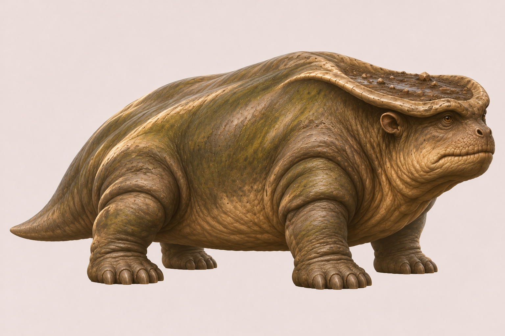

既存原画を再掲。骨格・接合・動作の記述は今回の制作提案。

monster.numeradon / 四足重獣 / 原画採用待ち・仮モデル

1. **保つ輪郭**: 低い泥皿、短く太い四脚、平たい腹、尾の泥ひれ。高い脚を足して一般的な四足へ寄せない。

2. **骨格**: 胸郭と骨盤の上下差を小さくし、短い上肢・下肢を明確に分ける。頸根→頭→泥皿の支持部を連結し、皿だけが頭から浮いて回転しない。泥皿の前後傾きは首と頭の動きで主に作る。

3. **支持**: 通常歩行は四足支持で腹をわずかに浮かせる。腹滑りは「後脚で押す→腹の接触パッチを増やす→脚を畳む→摩擦で減速→前脚を下ろす」の別モード。腹が地面を貫いたまま進まない。

4. **表面**: 皿は硬い鉱化殻、縁の水圧嚢と頬・腹は柔らかい連続皮膚。濡れは上面全体への均一な鏡面ではなく、皿内と水際、腹側の擦れに分ける。泥は皮膚の色に焼き込み過ぎず、厚みのある縁や塊を少数追加する。

5. **歩行／旋回**: 一歩の持上げを小さくし、外へ張る足裏で受ける。ゆっくり旋回するときは外側後脚を押し、頭皿の向きを後から追従。泥皿の内容物だけが慣性で少し遅れる。

6. **泥玉**: 首を引く→皿を後傾→水圧嚢が根元を固定したまま膨張→前傾時に皿前端から放出→嚢が縮む。飛び道具socketは口と混同せず皿前端へ置く。

7. **横押し**: 相手側の肩を下げる前に逆側の脚で押し、厚い腹皮は接触側へ圧縮する。全身を横へ平行移動させるだけにしない。

8. **追加図**: 正面幅、腹面、皿断面／水路、水圧嚢の縮／膨、歩行と腹滑りの断面。

*原PDFフッター: KARI / MONSTER ANATOMY DESIGN v2 / 16*

---

## 原PDF 17ページ — 鐘嚢獣 ボルナケル

*S P E C I E S  0 4  /  A N ATO M Y*

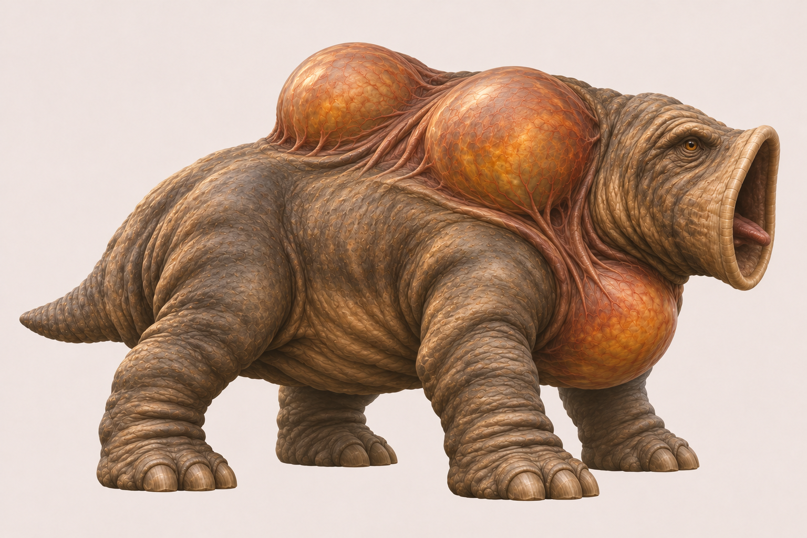

既存原画を再掲。骨格・接合・動作の記述は今回の制作提案。

monster.bornakel / 四足重獣 / 原画採用待ち・仮モデル

1. **保つ輪郭**: 鐘形の頭と胸・左右肩の3つの共鳴嚢。共鳴嚢は浮遊する球でなく、厚い根元で体へつながる。

2. **骨格**: 重い頭を支える短い首根と後頭、広い胸郭、肩甲・四肢を設ける。各嚢は付着リング＋中心制御＋形状補正を持つ。嚢全体を支点から伸縮する単純スケールだけに頼らない。

3. **支持**: 音圧姿勢は四肢をやや広げ、胸の下に支持域を作る。頭鐘の地面打ちは頭の質量で前へ倒れないよう、後脚を前方へ半歩入れ、前脚を着地前後で受け直す。

4. **皮膚と嚢**: 嚢基部は首・胸皮と一体の厚い縁、膨らむ腹は薄く、折り畳み線を残す。硬い共鳴弁と嚢膜の材質を分ける。光沢を一様にするとゴム風船に見えるため、根元の皺・湿った口・乾いた背皮の粗さを分ける。

5. **歩行／旋回**: 体は低く安定、嚢は歩行の一拍後に小さく追従し、停止で減衰する。3嚢を完全同相で揺らさないが、常時ばらばらに振動させもしない。

6. **前方音圧**: 吸気で胸が広がる→3嚢が段階的に張る→弁を閉じる準備→頭鐘を相手へ向けて解放→嚢膜が戻る。この連鎖を音と攻撃予告に同期し、輪郭だけで危険方向が読めるようにする。

7. **嚢の体当たり**: 打撃側の嚢を張って胸郭を反らし、逆側後脚で押す。嚢は接触時に少し潰れて戻り、硬い頭鐘は潰れない。

8. **追加図**: 頭鐘の口腔／弁、3嚢の前後・左右位置、全縮／全膨、嚢と肩の断面、足裏。

*原PDFフッター: KARI / MONSTER ANATOMY DESIGN v2 / 17*

---

## 原PDF 18ページ — 灰帷鳥 アシュレイア

*S P E C I E S  0 5  /  A N ATO M Y*

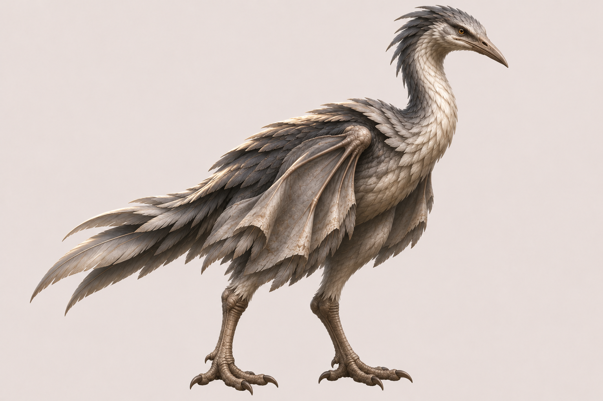

既存原画を再掲。骨格・接合・動作の記述は今回の制作提案。

monster.ashreia / 二足翼獣 / 原画採用待ち・仮モデル

1. **保つ輪郭**: 長首、垂れる短翼、冠羽と尾羽、翼内側の灰粉房。飛び続けず低く滑る設定を保つ。

2. **骨格**: 骨盤→大腿→膝→下腿→足首→中足→前趾／後趾。首はS字の数節で分け、単一の首棒を折らない。翼は胸側付け根→上腕→前腕→手部の3節以上を制御の基本にし、前肢として数える。追加の腕を生やさない。

3. **支持**: 頭と長首の前方質量を尾と骨盤で釣り合わせ、片脚立ちで支持足の上へ骨盤を寄せる。つま先を地面に固定したまま膝と足首を沈めて予備動作を作る。

4. **帷と粉房**: 翼の根元は筋肉と短い羽軸、垂れる縁は重ねた帷羽。独立した布の四角形を垂らさない。灰粉房は翼内側に固定し、粉の出口は前方へ翼を持ち上げたときに現れる。

5. **歩行／旋回**: 頭の上下動を胴より抑え、脚を入れ替えながら首で視線を安定。急旋回は短い踏み替えと翼の左右差で釣り合いを取る。滑走時は踏切・滞空／低滑走・着地を別区間にする。

6. **睡眠灰幕**: 両脚を沈める→上腕・前腕を順に上げる→粉房が露出→帷羽が根元から先へ遅れて払う→粉幕放出→翼を畳み接地を取り直す。

7. **嘴突き**: 首をS字へ折り畳み、脚で前へ押し、首根から順に伸ばす。頭と嘴を胴から独立して瞬間移動させない。開口は嘴上下の付け根で行う。

8. **追加図**: 正面／背面／上面、翼折畳みの関節図、翼下面の粉房、長首の畳み／伸び、足趾接地。

*原PDFフッター: KARI / MONSTER ANATOMY DESIGN v2 / 18*

---

## 原PDF 19ページ — 燐尾鳥 ルミスカ

*S P E C I E S  0 6  /  A N ATO M Y*

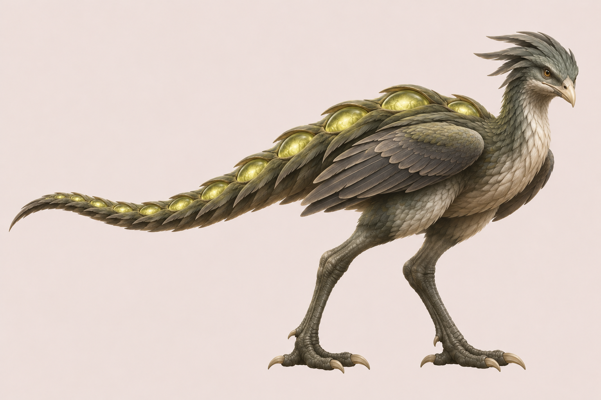

既存原画を再掲。骨格・接合・動作の記述は今回の制作提案。

monster.lumisca / 二足翼獣 / 原画採用待ち・仮モデル

1. **保つ輪郭**: 細い二足の身体、短翼、長く重い燐節尾。尾の燐節数は原画・現データの対応を固定してから正式化し、幼体は2節を必ず保つ。

2. **骨格**: 二足翼獣リグに、尾根の強い支点と多節尾を追加。硬い燐節の中心は対応尾骨へ固定し、節間の皮膚だけが曲がる。尾の全長を1本の棒として回さない。

3. **支持**: 静止時は尾を後ろへ置いて胸と釣り合わせる。片脚蹴りでは支持脚側へ骨盤を移し、尾を反対へ振る。重い尾を高く持ち上げても胴・脚が無反応にならない。

4. **表面**: 乾いた細鱗、燐節の硬い板、節間皮、濡れた目・口を分ける。発光は板の内側と縁へ抑え、白く飛ばして造形を隠さない。

5. **歩行／旋回**: 胴の旋回→尾根→尾中→尾先の順に追従。尾先の振れ幅が広すぎると壁を貫くため、旋回速度と身体配置から可動範囲を制限する。

6. **直線放電**: 姿勢を低く固定→燐節が順に灯る→尾根から曲げて尾先を地面近くへ置く→放電板socketと地面の位置から演出と判定を発生→残光後に尾を戻す。光が点いたことと接地が一致する。

7. **蹴り／跳込み**: 膝を上げる前に反対脚へ荷重、足首を畳んでから前趾を伸ばす。着地は足趾→足首→膝→骨盤の順で減速。短翼は姿勢制御の補助。

8. **追加図**: 尾の上面・断面、節間の最大曲げ、左右翼の厚さ、尾先と地面の接触、燐節の通常／予告／放電後。

*原PDFフッター: KARI / MONSTER ANATOMY DESIGN v2 / 19*

---

## 原PDF 20ページ — 硝殻蟹 オルグラス

*S P E C I E S  0 7  /  A N ATO M Y*

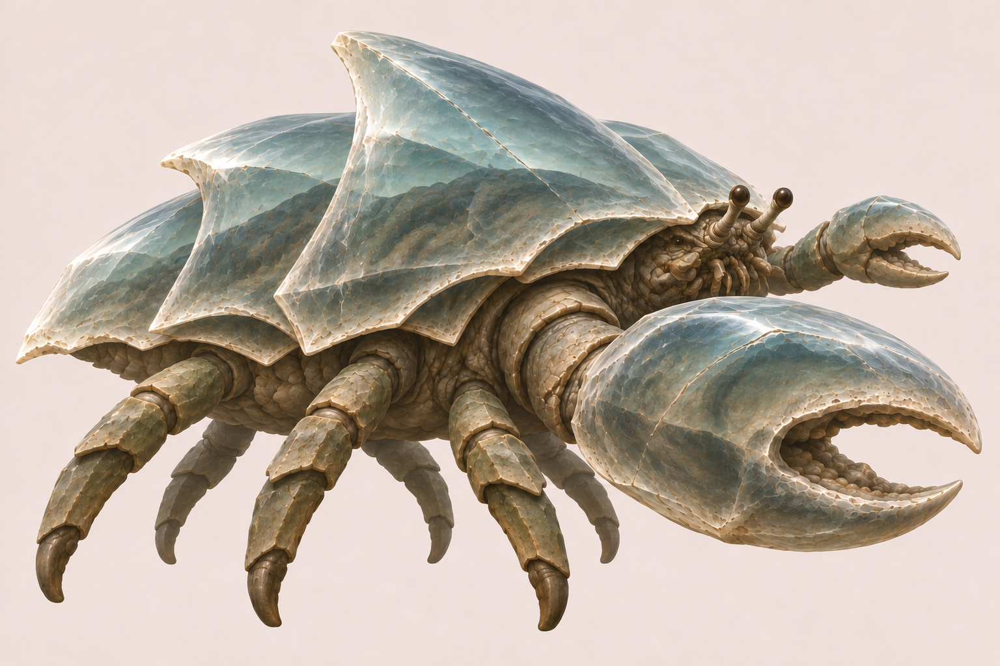

既存原画を再掲。骨格・接合・動作の記述は今回の制作提案。

monster.orglass / 六脚甲殻 / 原画採用待ち・仮モデル

1. **保つ輪郭**: **歩脚3対6本＋鋏脚2本**。右が大鋏、左が小鋏。左右を同じ大鋏にしない。複数枚の硝殻板と眼柄を保つ。

2. **骨格**: 胴甲を一つの硬い基準体とし、歩脚は基節→腕節相当→下節→足先へ分ける。各関節は殻に隠れた膜の位置で回転。鋏脚は根元・腕・掌部・可動指を別骨とし、固定指は掌部と一体。左右眼柄は根元で向けられるようにする。

3. **支持**: 低速は4〜5脚で受けつつ1〜2脚を運ぶ。速度が上がる場合のみ交互の支持組を使用し、動的バランスを検証する。大鋏を前へ出す時は逆側・後方の歩脚を広げて支える。

4. **硬殻と関節膜**: 甲・鋏・脚殻は剛体、関節間は暗く薄い膜。甲羅全体が呼吸で膨らまない。硝殻は縁と薄い部分に透け感を置き、身体全体を透明にして内部の交差が見える状態を避ける。

5. **横歩き／旋回**: 横移動方向へ脚先を運び、支持脚は地面に固定。旋回では各足先の目標を胴の回転円周に沿って更新。前後歩きの脚振りを90度回しただけにしない。

6. **右大鋏挟み**: 歩脚の支持拡張→鋏腕を後方へ引く→可動指を開く→腕を前へ送る→掌の固定指に向け可動指が閉じる→引き戻す。指先の見える軌道と攻撃カプセルを共通支点から作る。

7. **背板起こし**: 板の根元には重なりと小さな可動座を設ける。硬い板をゴム状に曲げない。壊れた板は別の欠け形状へ切り替える。

8. **追加図**: 上面・腹面の歩脚本数、右大鋏の開／閉／断面、左小鋏、背板展開、関節膜。原画は斜め要素があり、見える脚本数だけから断定せず現データの6歩脚を基準にする。

*原PDFフッター: KARI / MONSTER ANATOMY DESIGN v2 / 20*

---

## 原PDF 21ページ — 鉤輪蟲 テンガロ

*S P E C I E S  0 8  /  A N ATO M Y*

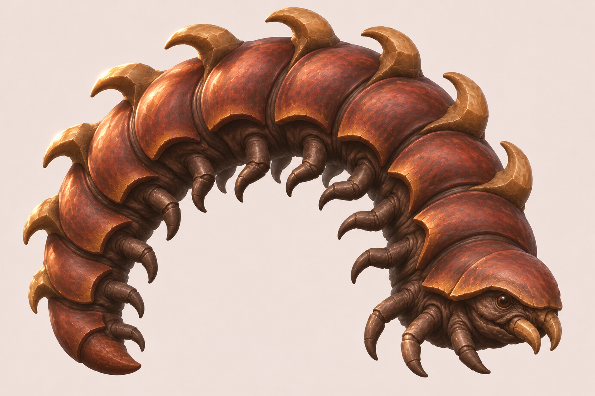

既存原画を再掲。骨格・接合・動作の記述は今回の制作提案。

monster.tengaro / 輪状多節甲殻 / 原画採用待ち・仮モデル

1. **保つ輪郭**: 円弧の体節列、外側の鉤、内側の小脚。現生成器では主節13、脚6対12本。これは現モデルの構成で、正式な体節分割は原画照合後に決める。

2. **骨格**: 中央節から頭側・尾側へ連なる階層を使い、各節に独立した屈曲軸を置く。身体の曲率を全節へ配分し、1節で折れない。輪留め節を頭尾の接続点として特別扱いする。

3. **支持**: 開いた状態は複数の内脚と地面に近い節が支える。輪化中は脚を内側へ収納し、外鉤と硬い外殻の接地点へ支持を切り替える。丸まる前から宙に浮かせない。

4. **外殻と膜**: 外側の板は1節1剛体。内側には縮む節間膜を作り、重なりの方向を統一。鉤は外殻へ太い基部で接続し、鉤そのものを生きた指のように曲げない。痺液は細い開口・溝で表す。

5. **輪化**: 頭側と尾側の曲率を上げる→内脚を畳む→頭尾の輪留め接近→接続の確認→輪の傾きを作る→回転へ移行。頭尾が完全接続しない造形なら輪留めの近接距離を明示し、絵と動作で同じ隙間を保つ。

6. **斜め転がり**: 回転角は移動距離と有効接触半径を関係付ける。鉤があるため正円の完全無滑り運動にはせず、鉤の接触で小さな上下動と回転速度変化を与える。停止では鉤を掛け、体節を開き脚支持へ戻す。

7. **局所反応**: 被弾節にだけ小さな縮みを加え、全節が同時に波打たない。輪留め損傷後は見た目の欠けと接続姿勢を対応させる。

8. **追加図**: 開いた全長、上面、節断面、輪化前／途中／閉、内脚収納、頭尾の輪留め。ミトガロンへ完全輪化を流用しない。

*原PDFフッター: KARI / MONSTER ANATOMY DESIGN v2 / 21*

---

## 原PDF 22ページ — 絹霧蟲 ヴェリト

*S P E C I E S  0 9  /  A N ATO M Y*

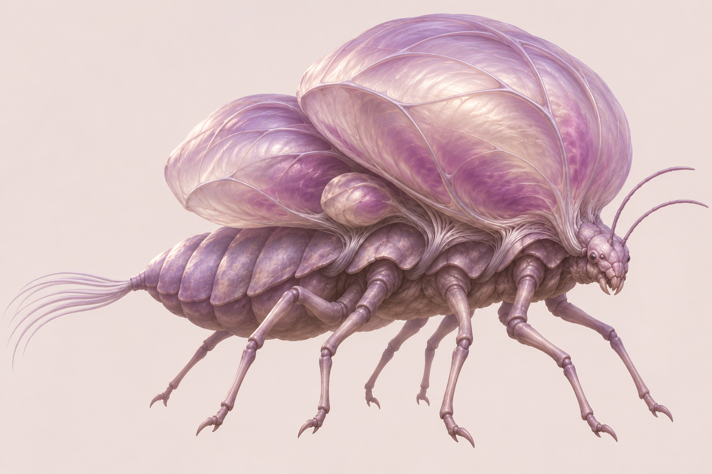

既存原画を再掲。骨格・接合・動作の記述は今回の制作提案。

monster.verito / 歩行型多脚甲殻 / 原画採用待ち・仮モデル

1. **保つ輪郭**: 細い4対8脚、前後に張る左右の羽袋、糸尾。羽袋は湿りを保つ器官で、飛行用の翼ではない。

2. **骨格**: 胸の短い基部と柔らかい節腹を分離し、各脚に付け根・膝相当・足先を置く。前脚1対は糸櫛として追加の末端回転を持つ。羽袋は前後×左右の根元制御、膨張は形状補正、尾は二筋の紡糸管と糸の根元を別socketにする。

3. **支持**: 少なくとも左右・前後に広がる支持脚を残しながら、脚を順送りで交換する。前脚で糸を引くときは後ろ3対を支持へ移し、胸の前後移動を抑える。

4. **表面**: 腹甲は硬い薄板、腹側は節間皮、羽袋は細い支持線のある薄膜。袋の根元を長く固定し、球が胴からぶら下がったような一点接続を避ける。膜の透明度を上げる前に厚みと内側の支えを描く。

5. **歩行／旋回**: 接地脚を保ち、足の入替えを前後でずらす。袋の揺れは胸の加速度へ遅れて反応。方向転換で左右の袋が常時交差しない。

6. **毒糸の面**: 尾端を狙いへ向ける→二筋の管口が開く→後脚で位置を保つ→管口から糸が出る→接地点と管口を結ぶ低い糸面が張る。現モデルの紡糸表示は4本のconeなので、機能上の管口2と描画上の糸分岐4を区別する設計確認が必要。

7. **短い跳躍**: 袋の収縮を予告にしつつ、実際の踏切は脚の伸展で作る。袋収縮だけで浮き上がるように見せない。着地時は前脚が先、残脚と腹が順に沈む。

8. **追加図**: 上面・腹面、8脚の取り付け位置、左右羽袋の付着縁、紡糸管2口と糸分岐、前脚糸櫛の拡大。

*原PDFフッター: KARI / MONSTER ANATOMY DESIGN v2 / 22*

---

## 原PDF 23ページ — 環骨蛇 ラズメル

*S P E C I E S  1 0  /  A N ATO M Y*

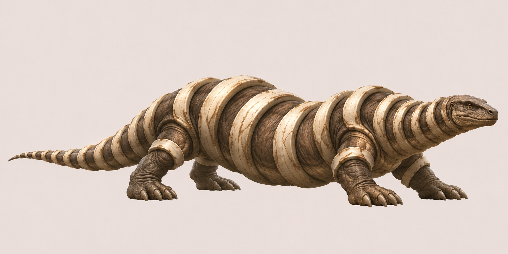

既存原画を再掲。骨格・接合・動作の記述は今回の制作提案。

monster.razmer / 短肢を持つ長胴 / 原画採用待ち・仮モデル

1. **保つ輪郭**: 胴を囲む骨環、二対の短い肢、長い尾。完全な無肢の蛇へ変えない。

2. **骨格**: 胴に連続する多数の節を置き、首側から尾側まで滑らかに曲げる。短肢は体側へ広がる付け根・肘／膝相当・足先。骨環の中心を対応節へ固定し、骨環と骨環の間で主に屈曲する。

3. **支持**: 胴の複数接触点＋4短肢の混合支持。通常移動は腹面の接触パッチを順に変え、短肢で押す。首を上げたときは支持する胴区間を広く残す。

4. **硬い環と皮膚**: 骨環は伸び縮みしない。環の間に折れる皮膚と環間靭帯を置き、内側の皮膚は圧縮、外側は伸張。環が曲げ外側で胴から浮き、内側で胴を貫く問題を断面で確認する。

5. **旋回**: 頭を進行方向へ向け、その軌跡を胴が時間差で追う。長い体全体を中心1点から回さない。尾は短い経路へ急に吸い付かないよう曲率制限を持つ。

6. **骨環叩き落し**: 4短肢と後胴で踏ん張る→前胴の数節を持上げる→骨環が床へ近づく→接触で局所停止→胴へ減衰。環を空中へ分離させて落とさない。

7. **直線這い突進**: 予告で短肢を畳むのは保持しつつ、胴の収縮と伸展・腹接触の切替で推進を説明する。前後の移動量と皮膚波の周期を合わせる。

8. **追加図**: 上面・腹面、骨環の完全断面、短肢の展開／収納、最大S字曲げ、骨環接地。現生成器では骨環の独立した立体部品が明示されず、模様依存になっていないか正式モデルで優先確認する。

*原PDFフッター: KARI / MONSTER ANATOMY DESIGN v2 / 23*

---

## 原PDF 24ページ — 氷帆蛇 キリサーヴ

*S P E C I E S  1 1  /  A N ATO M Y*

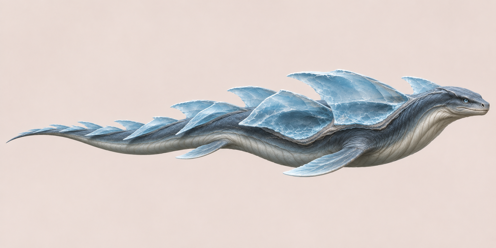

既存原画を再掲。骨格・接合・動作の記述は今回の制作提案。

monster.kirisave / ひれ足を持つ長胴 / 原画採用待ち・仮モデル

1. **保つ輪郭**: 長い胴、左右交互の薄い氷帆、二対の低いひれ足。v0.21.0でひれ足は可動化済み。

2. **骨格**: 胴の連続節に、帆ごとの付け根ヒンジ、ひれ足の根元・短い内部支持を置く。氷帆は全体で硬く、柔らかいのは根元の帆間皮。左右交互の並びを上面で明示する。

3. **支持**: 通常の這いは腹の複数接触点を支え、ひれ足が押出しと方向安定を助ける。滑走時は腹の滑る接触域を使い、ひれ足は畳む。すべての姿勢で4脚歩行IKを適用しない。

4. **材質**: 冷晶管は皮下の控えめな筋、氷は薄い縁と欠け、胴は湿った細鱗。帆をベタな白い三角板にせず、厚み、成長筋、基部の堆積を作る。透明は薄い部分に限定する。

5. **旋回**: 首の進行方向へ腹の接触パッチが順に移り、外側の帆の開きを抑える。急角度で帆同士が衝突しないよう、各帆の可動範囲と胴曲率を連動させる。

6. **氷片列**: 冷却予告→前側の帆から立つ→後方の帆へ波及→各帆の縁から欠片→帆が少し戻る。発生点は「頭の前の空中」ではなく、表示される帆縁のsocketへ対応。

7. **尾端叩き**: 胴の前半を接地したまま尾根→尾中の二段屈曲で尾先を持上げる。叩いた瞬間だけ尾先の接触を固定し、胴を引きずる反応を小さく戻す。

8. **追加図**: 上面・腹面、左右の帆の正確な交互配置、ひれ足断面、帆最大展開、滑走接触域。幼体ヒナサルヴは短肢を持つが、親から継承したfinと別の足が二重に見えない構造を確認する。

*原PDFフッター: KARI / MONSTER ANATOMY DESIGN v2 / 24*

---

## 原PDF 25ページ — 霧灯獣 ヴェルガイト

*S P E C I E S  1 2  /  A N ATO M Y*

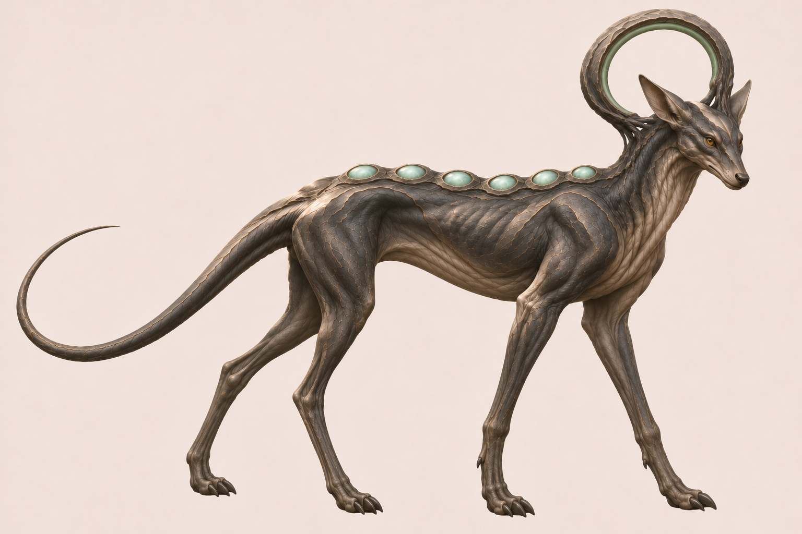

既存原画を再掲。骨格・接合・動作の記述は今回の制作提案。

monster.velgait / 四足軽獣 / 原画採用待ち・仮モデル

1. **保つ輪郭**: 環状頭冠、細い四足、背の灯節6つ、長い導霧皮尾。灯節を増やして豪華にしない。

2. **骨格**: 四足軽獣の身体に、首根・頭と環冠の固定座、尾の複数節を追加。灯節は背面の対応位置へ固定し、揺れる装飾球にしない。環冠の向きは頭の向きと結び、基部だけの微小可動に留める。

3. **支持**: 跳込み前に後脚で荷重、前脚を揃えて上げる際は骨盤を後方へ移す。後脚2本で立つ短い区間は、尾を逆側へ配して胴の角運動を抑える。

4. **材質と器官**: 灯節は硬い薄殻と内部発光、間の皮膚は柔らかく暗い。6節全体が同時に膨らまない。凝霧孔を頭冠の内側の顔面に確保し、霧球は孔から出る。

5. **歩行／旋回**: 静かな四拍の歩行を基調に、足先の位置が先に定まり、細い脚が追いつく。頭冠は視線の向きと共にゆっくり先行し、背中の灯節は身体に固定して揺れを最小にする。

6. **霧球**: 環冠を相手へ向ける→灯節が順に鈍く灯る→凝霧孔と口周囲に湿り→粘液膜の小球が出る→射出後に尾の導霧皮が落ち着く。発光と射出を同じ時間列へまとめる。

7. **横跳び突き**: 片肩を沈める→逆後脚で押す→頭冠を含む首の向き固定→突き→前脚着地→尾で姿勢回復。空中の方向追従で攻撃が不自然に曲がらない。

8. **追加図**: 頭冠の正面／側面と付着部、背面の灯節6位置、上面、導霧皮の尾断面、凝霧孔。前後2節ずつの破壊部位と中央2節を区別して対応表へ記載。

*原PDFフッター: KARI / MONSTER ANATOMY DESIGN v2 / 25*

---

## 原PDF 26ページ — 熾炉獣 エンバルグ

*S P E C I E S  1 3  /  A N ATO M Y*

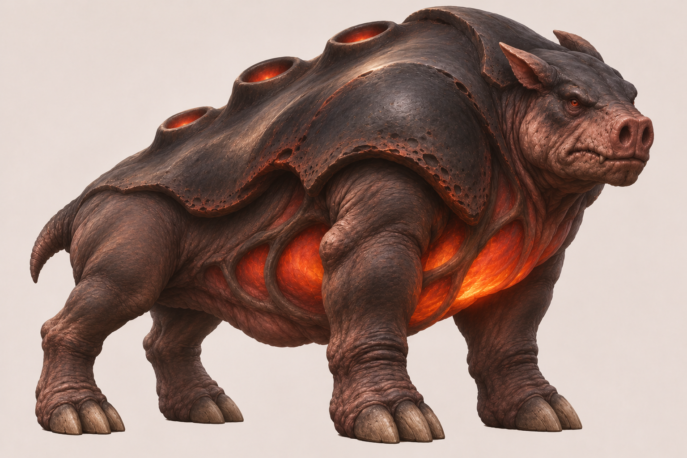

既存原画を再掲。骨格・接合・動作の記述は今回の制作提案。

monster.embarg / 四足重獣・原画段階 / 原画採用待ち・原画段階

1. **状態**: 原画のみで、戦闘モデル・骨格・技データの実装済み扱いをしない。以下は正式化候補で、採用待ちの輪郭からの設計。

2. **保つ輪郭**: 胸腹が前へ張り出す黒灰殻、低い背の排気弁。一般的な赤い竜や背中全面の炎へ変えない。

3. **骨格**: 重獣の胸郭・骨盤・四肢に、胸と腹の硬い炉殻、複数の排気弁の根元ヒンジを持つ。炉殻は一体の柔らかい袋ではなく、硬い板の間に呼吸用の皮膚余地を残す。

4. **支持**: 前へ張る胸腹に合わせ、前脚の足裏と肩の受けを広くする。呼気や重打で頭を前へ出す際、後脚を一歩寄せて支持域を変える。

5. **皮膚・殻・熱**: 黒灰殻は乾いた粗い面、隙間の弁縁は琥珀色、内部熱は奥へ限定。胸炉が明るくなる予告は維持するが、硬い炉殻そのものが風船のように膨張しない。殻間の皮膚と弁開口が拡がることで呼吸を見せる。

6. **熱息**: 前脚を開く→胸郭の吸気→胸腹の隙間が明るくなる→背弁の一部開口→頭を固定して短い呼気→胸の収縮と排気。背弁を全て同時にパタパタさせない。

7. **前脚重打／片側熱気**: 反対前脚と後脚へ荷重した後に攻撃脚を上げる。片側熱気は該当側の弁だけを開き、支持脚と向きを保つ。熱が出る器官と当たり方向を統一。

8. **追加図**: 正面・背面・上面、炉殻の断面、弁の閉／開、胸と腹の屈曲余地、熱息の出口。先にガルドロスとの輪郭・歩幅・肩位置の差を灰色モデルで比較する。

*原PDFフッター: KARI / MONSTER ANATOMY DESIGN v2 / 26*

---

## 原PDF 27ページ — 幼体8種の成長差 1/2

*J U V E N I L E S  /  1  O F  2*

成体とIDを区別し、器官の未発達と体型の差を保つ。現在の実装は仮モデルで、以下は正式化の設計。

### monster.kordopil コルドピル

**構造:** 左背だけの薄い幼岩板、小さな頭冠、短尾と丸い尾端晶。成体の剛体岩板リグを流用しても板枚数と体型は別定義。

**動作:** 丸腹・短い支持基底に合わせ小さな歩幅。前脚押し叩きは短い荷重移動で行い、成体の巨大な尾払いを縮尺だけで流用しない。正式足趾本数は成体との成長連続性を確認。

### monster.palseit パルセイト

**構造:** 小さな閉じた2枚の幼角膜、体より長く見える後脚。大型帆を単純縮小して全開形のままにしない。

**動作:** 頭と脚の比率に合わせ足を着き直す回数を増やす。低い飛び退きと小さな横蹴りで、支持脚の移動を残す。

### monster.numaporon ヌマポロン

**構造:** 浅い頭皿、短脚、尾の幼ひれ、未発達の一対幼水圧嚢。

**動作:** 少量の泥玉と短距離腹滑り。現生成器は親の可視sacsを除去しているため、幼嚢が内部にあって微小変形で見せるのか、外形に小嚢を残すのかを正式図で決める。

### monster.chilumicana チルミカナ

**構造: 尾の幼燐節は2つ**。短翼と小放電膜。v0.21.0の器官復旧を保持する。

**動作:** 2節の順点灯→近距離尾突き。長尾・多節の成体放電を流用しない。前蹴りの直前には反対脚へ骨盤を寄せる。

親のモーションを縮尺・速度だけ変えて済ませず、接地、跳躍の可否、器官の発達、攻撃の予告を個別に検収する。

*原PDFフッター: KARI / MONSTER ANATOMY DESIGN v2 / 27*

---

## 原PDF 28ページ — 幼体8種の成長差 2/2

*J U V E N I L E S  /  2  O F  2*

成体とIDを区別し、器官の未発達と体型の差を保つ。現在の実装は仮モデルで、以下は正式化の設計。

### monster.kohalgis コハルギス

**構造:** 歩脚6本、左右ほぼ同寸の小鋏、乳白の1枚背殻。右大鋏の非対称は未発達。

**動作:** 軽い短い横跳び。左右鋏の可動指は維持。成体の片側大鋏を前提にした大きな体幹傾斜を流用しない。

### monster.mitogaron ミトガロン

**構造:** 柔らかな節膜と丸い短鉤、輪留めが未完成。完全に閉じた輪形を作らない。

**動作:** 弧状の体当たりと擦り払いにする。**成体の斜め回転はできない**という既存設定を維持し、止まると脚で支持を回復する。

### monster.yurtepica ユルテピカ

**構造:** 平たい幼羽袋、短い2筋の尾糸と細紡糸管。v0.21.0の紡糸管復旧を保持する。

**動作:** 短い毒糸払いと小さな跳び退き。袋は飛行用ではない。短い脚で跳ぶ予備圧縮を描き、糸の発生socketを管口に合わせる。

### monster.hinasalv ヒナサルヴ

**構造:** 丸い小帆板を左右交互、よく見える二対の短肢。成体の帆はまだ形成しない。

**動作:** 這いが中心で短い滑り。親から継承するfin0/fin1と追加短肢が別の肢として重なっていないかを確認し、成長後にひれ足になる**同じ2対**として設計する。

親のモーションを縮尺・速度だけ変えて済ませず、接地、跳躍の可否、器官の発達、攻撃の予告を個別に検収する。

*原PDFフッター: KARI / MONSTER ANATOMY DESIGN v2 / 28*

---

## 原PDF 29ページ — 同じ姿勢から、見た目と判定を作る

*SYST E M  /  P O S E*

Kariの既存契約は60Hz固定tickとin-placeクリップ。移動はcontrollerが担う。新リグもこの契約を保つ。[R8]

1. 移動衝突を解き、実際のroot位置・向き・移動量を確定する。

2. actionIdとローカルtickから基本姿勢を評価する。歩行位相は実移動量から進める。

3. 支持足・地面・胸と骨盤を解き、判定部に関わるIKや被弾補正を含む共通姿勢を確定する。

4. この姿勢から攻撃socketと、攻撃を受ける部位のアンカーを求める。

5. 既存のshapeTrackとの誤差を確認し、戦闘判定を進める。描画は前後tickの姿勢を補間する。

6. 判定部を動かさない小さな瞼・装飾・膜端の微動だけを描画側で追加する。

**移行は二段階にする。** まず現行shapeTrackを正本とし、攻撃の有効区間では見える攻撃部位を合わせる。支持IKで合わなくなるなら判定側の足場・姿勢契約まで改める。新しい共通姿勢から軌道を採用する段階は、範囲が変わる可能性を別に確認する。描画だけ新しいIK、攻撃だけ旧トラックという不一致を残さない。

一般リグには173本の焼き込み経路がすでにある。ただし現在の検査はroot静止・time=0などの生成条件での一致を確認する。自由な視線、怯み、地形補正、30/60fps、全tickの補間誤差まで検証したとは扱わない。[R9]

被攻撃部位は頭、胸、骨盤、前後脚、尾などに骨アンカーを持たせる。移動用の押し戻し形状と分け、首が動くたびに本体の衝突円まで変形させない。高速度の爪・尾は前後tick間の軌道も扱い、点のサンプルだけで抜けを判断しない。

ヒットストップ中はaction tickと攻撃姿勢を止める。怯み、転倒、捕獲、死亡へ移ったら足アンカー・活性窓・未発火イベントを整理する。描画側のクリップ終了通知で死亡後に攻撃状態へ戻さない。

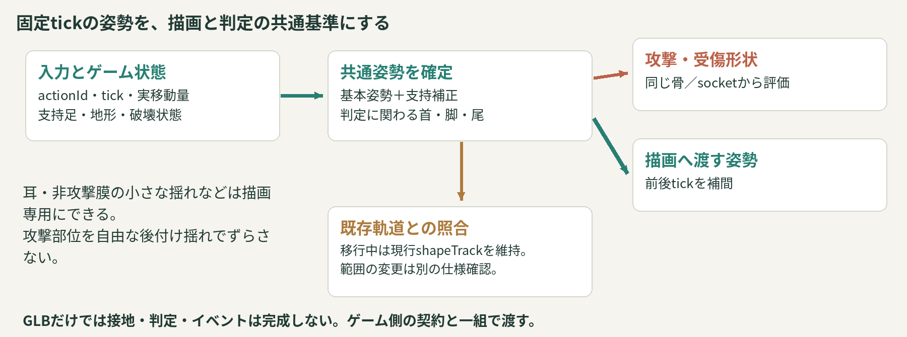

ゲーム時刻と共通姿勢を基準にする将来構成。現行実装済みの図ではない。

*原PDFフッター: KARI / MONSTER ANATOMY DESIGN v2 / 29*

---

## 原PDF 30ページ — 制作ファイルから、実行用モデルへ

*SYST E M  /  A SS E TS*

**制作リグと書き出しリグを分ける。** Blenderの制御用IKや補助ハンドルをそのままゲームへ持ち込むのではなく、変形骨・必要なsocket・ベイク済みの動作・補正形状を受け渡す。glTFはノード変換とモーフのキーを運ぶが、ゲームの再生順やイベント動作を定義しない。[E1]

| 納品単位 | 必須の内容 |
| --- | --- |
| 外見図 | 正面・背面・左右・上面。同一縮尺、基準姿勢、器官の付根と断面 |
| 編集元 | 制作ファイル、スケール、前方、骨名・制御骨・変形骨の区別 |
| 実行モデル | GLB、LOD、UV、材質画像、bone/socket対応、最大姿勢の境界 |
| 動作 | 既存clip名とdurationTicks、接地区間、左右差、切断・破壊差分 |
| 判定 | 攻撃点／受傷部位の対応、軌道生成元、差分、許容誤差 |
| 確認映像 | ゲーム距離で通常速、0.25倍、判定重ね、正面・横・斜め後ろ |

GLBを再読込し、単位・左右・法線・ウェイト・材質・clipの欠落を照合する。名前の欠落を似た名前へ自動で置き換えない。現行の数値骨番号に依存する処理は対応表を通して移行する。

最大開口、翼展開、尾払い、転倒を含む保守的な境界を設定するか、動作に追従する境界を更新する。静止姿勢の境界だけで画面端の可視判定をすると、動いてはみ出した部位が消える原因になる。[E2]

同種のgeometryや画像は共有できる。骨格状態、足アンカー、破壊状態は個体ごとに持つ。Three.jsのSkeletonUtils.cloneは骨とskinの対応を保つ一方、geometry/materialは参照共有されるため、個体別の色・破壊の扱いを分ける。[E3]

生成物だけを手直しせず、tools/gen-monsters.py・monster_lib.py・動作生成器の入力側へ採用内容を反映する。実装担当Claudeがゲーム組込みと受入検査を行う。

*原PDFフッター: KARI / MONSTER ANATOMY DESIGN v2 / 30*

---

## 原PDF 31ページ — 密度を上げる場所と、実機予算を分ける

*SYST E M  /  B U D G E T*

以下は実測済みの性能ではなく、正式モデルの**初期予算案**。ガルドロス以外の全個体へ79骨を適用しない。ノード数より、同時個体数、画面占有率、スキニング頂点数、透明面の重なり、影の描画を合わせて計測する。

| 対象 | 近距離LOD0 | 中距離LOD1 | 遠距離LOD2 |
| --- | --- | --- | --- |
| 通常大型 | 12,000〜20,000 tri | 6,000〜10,000 | 2,000〜4,000 |
| 岩殻が多い大型 | 16,000〜24,000 tri | 8,000〜12,000 | 3,000〜5,000 |
| 幼体 | 4,000〜8,000 tri | 2,000〜4,000 | 800〜1,500 |

triは書き出し後の三角形数。現在のモデルの測定値ではない。顔、打撃面、殻の輪郭、関節を残し、見えにくい裏面と微細な凹凸を削る。最初は全LODで骨とsocketの意味をそろえ、骨LODは後から検討する。

材質は皮、硬殻、必要な膜、眼・発光などを2〜4区分から始める。15岩板を15個の独立draw callにする必要はなく、材質を共有したスキンメッシュへまとめ、各板だけ1骨へ剛体的に割り当てられる。材質数と実描画回数は別に測る。

画像は1Kを初期候補とし、近距離の顔や殻へ2Kを配分する。RGBA8の2048²画像は非圧縮で16MiB、ミップ込み約21.3MiB/枚。3枚なら約64MiBという計算になる。これはフォーマットを仮定した容量計算で、現在のGPU使用量ではない。転送用WebPの小ささとGPUメモリを同一視しない。

実機の代表条件は、大型1＋幼体5の近接戦、最大器官展開、破壊直後、エリア切替。既存の環境描画を含む合計で、描画間隔の平均・p95・100ms超の回数、GPU画像量、draw callを記録する。30fpsなら33.3msを計画上の目安にするが、特定iPhoneで達成済みとは扱わない。

負荷超過時は小さな装飾の更新、遠方LOD、透明面と影、画像解像度の順に検討する。判定の固定tickや攻撃の予備動作をフレームレート調整のために縮めない。

*原PDFフッター: KARI / MONSTER ANATOMY DESIGN v2 / 31*

---

## 原PDF 32ページ — 採用する順番と、完了の判定

*P R O D U CT I O N  /  O R D E R*

「全種を一度に細かくする」より、代表1体で骨格・肌・判定まで通して品質基準を作り、体型ごとに展開する。この依頼は設計を進める許可であり、採用待ち原画を正式採用済みへ変更するものではない。

| 段階 | 対象と作業 | 完了したと判断する成果 |
| --- | --- | --- |
| P0 | 一般顎、支持足、被攻撃部位アンカーの設計を実装へ反映 | 既存IDと技窓を保って、口・足・部位が動作へ接続 |
| P1 | ガルドロスの灰色モデル、79ノード案、肌と板、叩き・噛み・尾払い | 正面幅、接地、変形、判定を同じモデルで確認 |
| P2 | セルヴァルク | 軽い四足、踏切・着地、分割角膜を独立して成立 |
| P3 | アシュレイア、オルグラス | 二足＋翼、六脚＋鋏の違う支持構造を検証 |
| P4 | テンガロ、ヴェリト、ラズメル、キリサーヴ | 輪化、多脚、長胴の個別接触方式を完成 |
| P5 | 残る主要種と幼体、エンバルグ | 固有器官と成長差。親を縮めただけの幼体にしない |
| P6 | 計画65種・巨躯 | 体型台帳から必須器官を足し、各種の設定図から確定 |

**最初に比較する映像:** 待機5秒→低速歩行→停止→90°旋回→前脚叩き→噛み→尾払い→怯み→転倒起床→部位破壊。通常速度・ゲーム距離を主評価、近接・スローを原因確認に使う。

担当はAGENTS.mdどおり、ChatGPTが外見・構造・動作演出の設計、Claudeがコード・データ・検証・公開。今回の提出は chatgpt-inbox/user-20261125-monster-anatomy/ のみ。mainへ直接反映せず、PRでレビュー可能にする。[R10]

*原PDFフッター: KARI / MONSTER ANATOMY DESIGN v2 / 32*

---

## 原PDF 33ページ — 受入条件は、見た目と数値の両方で持つ

*P R O D U CT I O N  /  A CC E PTA N C E*

数値は本設計の初期受入目標で、全種共通の自然法則や達成済み結果ではない。器官の大きさや狩りの距離で個別調整する。

| 確認項目 | 初期目標／合格の内容 |
| --- | --- |
| 体の厚み | 正面・横・上で肩、腹、骨盤が設定図の基準点と一致。横だけ合っていない |
| 骨・ウェイト | 一根、親の循環なし、必須名あり、最大4影響、正規化、反転なし |
| 足の接地 | 平地の低速支持中、掌基準点の横滑り2cm以内。意図した滑走・蹴りは明示 |
| 地形 | 将来の段差検査として5/10/20cmと斜面を試す。失敗時の踏替え・姿勢制限を規定 |
| 関節 | 最大屈曲・開口・旋回で皮の裂け、硬殻のゴム変形、肩の脱落がない |
| 攻撃同期 | active全tickと補間点で基準socketと採用軌道の誤差2cm以内を初期目標 |
| 受傷部位 | 頭・尾・脚が歩行、技、怯み、転倒、破壊後の姿勢を追う |
| 決定性 | 同じ入力で30/60fps描画の戦闘結果が一致。ヒットストップ中も同様 |
| 破壊とLOD | 切断面が閉じ、骨・socket・当たりが対応。LODで無傷へ戻らない |
| 器官 | 全種の必須器官が存在。開閉・膨張・収納を個別に確認できる |
| 通常速 | 重さ、支持、器官の予兆、空振り後の立直りをゲーム距離で読める |
| 実機 | 対象iPhone Safariの端末・OS・画質・同時数を記録して負荷を確認 |

判定カプセルは設計上の幅を持つため、「表面の全頂点と2cm以内」を意味しない。socketの対応点の誤差と、攻撃の許容範囲を分けて評価する。

今回確認したことは、ソース監査、79ノード案の構造検査、制作台帳と登録IDの照合、資料の出力確認。ゲームの正式モデルや動作がこの表を通過したという意味ではない。

*原PDFフッター: KARI / MONSTER ANATOMY DESIGN v2 / 33*

---

## 原PDF 34ページ — 今回の確認結果と、残る判断

*V E R I F I C AT I O N  /  L I M I TS*

| 実施 | 結果 |
| --- | --- |
| 指示・現在地 | AGENTS、掲示板、引継ぎ、規格、原画資料を確認 |
| 既存実装監査 | 53骨、一般19体の構築数、顎・翼・指・接地・被攻撃部位をソース確認 |
| 修正済み項目 | 幼体2種の器官とキリサーヴひれ足を再確認 |
| 依存導入 | Node v24.22.3、npm ci 成功、50 packages |
| ビルド | npm run build 成功（既存ゲームのビルド） |
| 関連検査 | npm exec vitest run tests/creature-motion.test.ts 8件成功 |
| 設計データ | 全79ノードの親・循環・一根、登録86IDの一致を検査 |
| PDF | 全ページを画像化して、文字・図・余白・ページ分割を確認 |

**未確認:** 新79ノードのGLB、ウェイト、補正形状、アニメーションクリップはまだない。現在の全種を通常速度で観察した評価、実機iPhoneの負荷、現在の実三角形数、新設計での足滑り・攻撃誤差は未計測。ローカルChromiumは環境のsocket制限で起動できず、今回のゲーム画面確認は行えていない。

**迷って決めたこと:** 掲示板番号のない直接依頼なので提出名に user-20261125-monster-anatomy を使う。ガルドロスのゲーム内寸法5.8mを維持し、図鑑8.5mとの統一は別課題として残す。前脚5制御と後脚3制御群、79ノード、可動域、LODは制作提案。正式採用待ち原画を確定扱いしない。

**守れなかった決まり:** 設計資料の出力・inbox限定には違反なし。完成モデル／通常速度の実機検収は今回の成果物範囲外で、合格扱いしない。モンスターの名前・属性・生態・技数を変更するbestiaryインポートJSONは作成していない。設計用JSONは bestiary:import の入力ではない。

**Claudeへ:** 顎・支持・部位追従を先に接続する。モデル更新時は生成元を直し、現行の技窓とIDを保って再ベイクを照合する。ヒナサルヴの短肢とひれの重複、ヴェリトの表示枝と機能socket、ヌマポロンの体内嚢を設計書の方針に合わせて整理する。

*原PDFフッター: KARI / MONSTER ANATOMY DESIGN v2 / 34*

---

## 原PDF 35ページ — 79ノードの親子と支点 1/3

*A P P E N D I X  A  /  1  O F  3*

**actor空間の支点座標(m)。** 元データ由来と提案追加を分ける。局所軸・bind matrix・ウェイトは未確定。座標をそのままGLBへ読み込めるという意味ではない。

| ノード名 | 親 | X / Y / Z (m) | 出自 |
| --- | --- | --- | --- |
| root | なし | 0.000 / 0.000 / 0.000 | 現行 0 |
| body | root | 0.000 / 1.250 / 0.000 | 現行 1 |
| lumbar | body | 0.000 / 1.250 / -0.350 | 現行 2 |
| pelvis | lumbar | 0.000 / 1.250 / -0.950 | 現行 3 |
| thorax | body | 0.000 / 1.250 / 0.350 | 現行 4 |
| chest | thorax | 0.000 / 1.250 / 0.950 | 現行 5 |
| ribs_l | body | 0.000 / 1.200 / 0.150 | 現行 6 |
| neck_01 | chest | 0.000 / 1.340 / 1.400 | 現行 7 |
| neck_02 | neck_01 | 0.000 / 1.500 / 1.630 | 現行 8 |
| head | neck_02 | 0.000 / 1.600 / 1.820 | 現行 9 |
| jaw | head | 0.000 / 1.440 / 1.840 | 現行 10 |
| tongue_01 | jaw | 0.000 / 1.440 / 2.100 | 現行 11 |
| lid_l | head | 0.375 / 1.735 / 2.200 | 現行 12 |
| lid_r | head | -0.375 / 1.735 / 2.200 | 現行 13 |
| tail_01 | pelvis | 0.000 / 1.000 / -1.500 | 現行 14 |
| tail_02 | tail_01 | 0.000 / 0.915 / -1.680 | 現行 15 |
| tail_03 | tail_02 | 0.000 / 0.843 / -1.860 | 現行 16 |
| tail_04 | tail_03 | 0.000 / 0.789 / -2.040 | 現行 17 |
| tail_05 | tail_04 | 0.000 / 0.750 / -2.220 | 現行 18 |
| tail_06 | tail_05 | 0.000 / 0.720 / -2.420 | 現行 19 |
| tail_07 | tail_06 | 0.000 / 0.700 / -2.620 | 現行 20 |
| tail_08 | tail_07 | 0.000 / 0.693 / -2.820 | 現行 21 |
| scapula_l | chest | 0.780 / 1.700 / 0.820 | 追加案 |
| fore_upper_l | scapula_l | 1.000 / 1.500 / 1.050 | 現行 22 |
| fore_lower_l | fore_upper_l | 1.133 / 0.792 / 0.808 | 現行 23 |
| wrist_l | fore_lower_l | 1.100 / 0.200 / 1.180 | 現行 24 |
| palm_l | wrist_l | 1.100 / 0.070 / 1.420 | 現行 25 |

root込み79。尾8・岩板15・追加26。socket12は別枠。既存53支点の位置保持は、動作や変形の合格を意味しない。

*原PDFフッター: KARI / MONSTER ANATOMY DESIGN v2 / 35*

---

## 原PDF 36ページ — 79ノードの親子と支点 2/3

*A P P E N D I X  A  /  2  O F  3*

**actor空間の支点座標(m)。** 元データ由来と提案追加を分ける。局所軸・bind matrix・ウェイトは未確定。座標をそのままGLBへ読み込めるという意味ではない。

| ノード名 | 親 | X / Y / Z (m) | 出自 |
| --- | --- | --- | --- |
| scapula_r | chest | -0.780 / 1.700 / 0.820 | 追加案 |
| fore_upper_r | scapula_r | -1.000 / 1.500 / 1.050 | 現行 26 |
| fore_lower_r | fore_upper_r | -1.133 / 0.792 / 0.808 | 現行 27 |
| wrist_r | fore_lower_r | -1.100 / 0.200 / 1.180 | 現行 28 |
| palm_r | wrist_r | -1.100 / 0.070 / 1.420 | 現行 29 |
| hind_upper_l | pelvis | 0.950 / 1.400 / -1.050 | 現行 30 |
| hind_lower_l | hind_upper_l | 1.077 / 0.791 / -0.688 | 現行 31 |
| hock_l | hind_lower_l | 1.040 / 0.200 / -0.980 | 現行 32 |
| metatarsus_l | hock_l | 1.040 / 0.070 / -0.740 | 現行 33 |
| hind_upper_r | pelvis | -0.950 / 1.400 / -1.050 | 現行 34 |
| hind_lower_r | hind_upper_r | -1.077 / 0.791 / -0.688 | 現行 35 |
| hock_r | hind_lower_r | -1.040 / 0.200 / -0.980 | 現行 36 |
| metatarsus_r | hock_r | -1.040 / 0.070 / -0.740 | 現行 37 |
| plate_back_01_l | thorax | 0.426 / 2.305 / 0.825 | 現行 38 |
| plate_back_01_r | thorax | -0.426 / 2.305 / 0.825 | 現行 39 |
| plate_back_02_l | body | 0.825 / 2.180 / -0.100 | 現行 40 |
| plate_back_02_r | body | -0.825 / 2.180 / -0.100 | 現行 41 |
| plate_back_03_l | lumbar | 0.393 / 2.109 / -0.985 | 現行 42 |
| plate_back_03_r | lumbar | -0.393 / 2.109 / -0.985 | 現行 43 |
| plate_head_l | head | 0.230 / 2.000 / 2.060 | 現行 44 |
| plate_head_r | head | -0.230 / 2.000 / 2.050 | 現行 45 |
| plate_shoulder_l | chest | 1.200 / 1.620 / 1.000 | 現行 46 |
| plate_shoulder_r_main | chest | -1.150 / 1.680 / 1.080 | 現行 47 |
| plate_shoulder_r_small | chest | -1.220 / 1.320 / 1.320 | 現行 48 |
| plate_hip_l | pelvis | 1.100 / 1.480 / -1.140 | 現行 49 |
| plate_hip_r | pelvis | -1.050 / 1.500 / -1.200 | 現行 50 |
| plate_forearm_l | fore_lower_l | 1.600 / 0.660 / 1.220 | 現行 51 |

root込み79。尾8・岩板15・追加26。socket12は別枠。既存53支点の位置保持は、動作や変形の合格を意味しない。

*原PDFフッター: KARI / MONSTER ANATOMY DESIGN v2 / 36*

---

## 原PDF 37ページ — 79ノードの親子と支点 3/3

*A P P E N D I X  A  /  3  O F  3*

**actor空間の支点座標(m)。** 元データ由来と提案追加を分ける。局所軸・bind matrix・ウェイトは未確定。座標をそのままGLBへ読み込めるという意味ではない。

| ノード名 | 親 | X / Y / Z (m) | 出自 |
| --- | --- | --- | --- |
| plate_forearm_r | fore_lower_r | -1.580 / 0.640 / 1.220 | 現行 52 |
| ribs_r | body | 0.000 / 1.200 / 0.150 | 追加案 |
| tongue_02 | tongue_01 | 0.000 / 1.440 / 2.300 | 追加案 |
| eye_l | head | 0.375 / 1.735 / 2.200 | 追加案 |
| eye_r | head | -0.375 / 1.735 / 2.200 | 追加案 |
| fore_lower_twist_l | fore_lower_l | 1.116 / 0.496 / 0.994 | 追加案 |
| digit_01_l | palm_l | 0.740 / 0.110 / 1.446 | 追加案 |
| digit_02_l | palm_l | 0.980 / 0.110 / 1.482 | 追加案 |
| digit_03_l | palm_l | 1.220 / 0.110 / 1.482 | 追加案 |
| digit_04_l | palm_l | 1.460 / 0.110 / 1.446 | 追加案 |
| digit_05_l | wrist_l | 1.000 / 0.240 / 0.820 | 追加案 |
| fore_lower_twist_r | fore_lower_r | -1.116 / 0.496 / 0.994 | 追加案 |
| digit_01_r | palm_r | -0.740 / 0.110 / 1.446 | 追加案 |
| digit_02_r | palm_r | -0.980 / 0.110 / 1.482 | 追加案 |
| digit_03_r | palm_r | -1.220 / 0.110 / 1.482 | 追加案 |
| digit_04_r | palm_r | -1.460 / 0.110 / 1.446 | 追加案 |
| digit_05_r | wrist_r | -1.000 / 0.240 / 0.820 | 追加案 |
| hind_lower_twist_l | hind_lower_l | 1.059 / 0.495 / -0.834 | 追加案 |
| toes_inner_l | metatarsus_l | 0.770 / 0.100 / -0.660 | 追加案 |
| toes_middle_l | metatarsus_l | 1.040 / 0.100 / -0.620 | 追加案 |
| toes_outer_l | metatarsus_l | 1.310 / 0.100 / -0.660 | 追加案 |
| hind_lower_twist_r | hind_lower_r | -1.059 / 0.495 / -0.834 | 追加案 |
| toes_inner_r | metatarsus_r | -0.770 / 0.100 / -0.660 | 追加案 |
| toes_middle_r | metatarsus_r | -1.040 / 0.100 / -0.620 | 追加案 |
| toes_outer_r | metatarsus_r | -1.310 / 0.100 / -0.660 | 追加案 |

root込み79。尾8・岩板15・追加26。socket12は別枠。既存53支点の位置保持は、動作や変形の合格を意味しない。

*原PDFフッター: KARI / MONSTER ANATOMY DESIGN v2 / 37*

---

## 原PDF 38ページ — 全86種の制作台帳 1/5

*A P P E N D I X  B  /  1  O F  5*

全86種の現行ID・表示名・状態を維持。制作テンプレートは候補であり、計画種の骨数・脚数・器官配置を確定した表ではない。

| No. | 種／固定ID | 制作テンプレート候補 | 現行状態 |
| --- | --- | --- | --- |
| 1 | ガルドロス monster.galdros | 四足重獣 | 仮モデル実装 |
| 2 | セルヴァルク monster.selvark | 四足軽獣 | 仮モデル実装 |
| 3 | ヌメラドン monster.numeradon | 四足重獣 | 仮モデル実装 |
| 4 | ボルナケル monster.bornakel | 四足重獣 | 仮モデル実装 |
| 5 | アシュレイア monster.ashreia | 二足＋短翼 | 仮モデル実装 |
| 6 | ルミスカ monster.lumisca | 二足＋短翼 | 仮モデル実装 |
| 7 | オルグラス monster.orglass | 六歩脚＋鋏脚 | 仮モデル実装 |
| 8 | テンガロ monster.tengaro | 輪状多節・成体 | 仮モデル実装 |
| 9 | ヴェリト monster.verito | 8歩脚＋非飛行羽袋 | 仮モデル実装 |
| 10 | ラズメル monster.razmer | 長胴・短肢の有無は個別確認 | 仮モデル実装 |
| 11 | キリサーヴ monster.kirisave | 長胴・短肢の有無は個別確認 | 仮モデル実装 |
| 12 | ヴェルガイト monster.velgait | 四足軽獣 | 仮モデル実装 |
| 13 | エンバルグ monster.embarg | 四足重獣 | 原画段階 |
| 14 | コルドピル monster.kordopil | 四足重獣 | 仮モデル実装 |
| 15 | パルセイト monster.palseit | 四足軽獣 | 仮モデル実装 |
| 16 | ヌマポロン monster.numaporon | 四足重獣 | 仮モデル実装 |
| 17 | チルミカナ monster.chilumicana | 二足＋短翼 | 仮モデル実装 |
| 18 | コハルギス monster.kohalgis | 六歩脚＋鋏脚 | 仮モデル実装 |

No.57の表示名テムソギアはID monster.tarhegna、No.71のセオルミドはmonster.segranioを維持する。登録名に合わせてIDを作り直さない。

*原PDFフッター: KARI / MONSTER ANATOMY DESIGN v2 / 38*

---

## 原PDF 39ページ — 全86種の制作台帳 2/5

*A P P E N D I X  B  /  2  O F  5*

全86種の現行ID・表示名・状態を維持。制作テンプレートは候補であり、計画種の骨数・脚数・器官配置を確定した表ではない。

| No. | 種／固定ID | 制作テンプレート候補 | 現行状態 |
| --- | --- | --- | --- |
| 19 | ミトガロン monster.mitogaron | 輪状多節・完全輪化不可 | 仮モデル実装 |
| 20 | ユルテピカ monster.yurtepica | 8歩脚＋幼羽袋 | 仮モデル実装 |
| 21 | ヒナサルヴ monster.hinasalv | 長胴・短肢の有無は個別確認 | 仮モデル実装 |
| 22 | ハスドレン monster.hasdren | 四足重獣 | 計画 |
| 23 | イヴセラム monster.ivselam | 四足軽獣 | 計画 |
| 24 | ドメルカノ monster.domelkano | 四足重獣 | 計画 |
| 25 | ホルネバス monster.holnebas | 四足重獣 | 計画 |
| 26 | ミルタセア monster.miltasea | 二足＋短翼 | 計画 |
| 27 | タルグリナ monster.talgrina | 六歩脚＋鋏脚 | 計画 |
| 28 | ザネトルカ monster.zanetolka | 多節・輪状/歩行を要確認 | 計画 |
| 29 | ウルナセト monster.ulnaset | 長胴・短肢の有無は個別確認 | 計画 |
| 30 | ネムボラフ monster.nemboraf | 巨躯・個別設計 | 計画 |
| 31 | ボラゼルン monster.borazeln | 巨躯・個別設計 | 計画 |
| 32 | クドリマル monster.kudrimal | 巨躯・個別設計 | 計画 |
| 33 | トサムリエ monster.tosamurie | 四足軽獣 | 計画 |
| 34 | プクレノア monster.pukrenoa | 四足重獣 | 計画 |
| 35 | ケサルピナ monster.kesalpina | 二足＋短翼 | 計画 |
| 36 | リプタウム monster.riptaum | 六歩脚＋鋏脚 | 計画 |

No.57の表示名テムソギアはID monster.tarhegna、No.71のセオルミドはmonster.segranioを維持する。登録名に合わせてIDを作り直さない。

*原PDFフッター: KARI / MONSTER ANATOMY DESIGN v2 / 39*

---

## 原PDF 40ページ — 全86種の制作台帳 3/5

*A P P E N D I X  B  /  3  O F  5*

全86種の現行ID・表示名・状態を維持。制作テンプレートは候補であり、計画種の骨数・脚数・器官配置を確定した表ではない。

| No. | 種／固定ID | 制作テンプレート候補 | 現行状態 |
| --- | --- | --- | --- |
| 37 | セリノダム monster.serinodam | 多節・輪状/歩行を要確認 | 計画 |
| 38 | ヌフラケン monster.nufraken | 長胴・短肢の有無は個別確認 | 計画 |
| 39 | アカウネル monster.akaunel | 二足＋短翼 | 計画 |
| 40 | ツマロベク monster.tsumarobek | 四足重獣 | 計画 |
| 41 | フレムサド monster.furemsad | 長胴・短肢の有無は個別確認 | 計画 |
| 42 | グラセドン monster.grasedon | 四足重獣 | 計画 |
| 43 | リュゼルカ monster.ryuzelka | 四足軽獣 | 計画 |
| 44 | モルディネ monster.mordine | 四足重獣 | 計画 |
| 45 | ドベルケン monster.doberken | 四足重獣 | 計画 |
| 46 | シルハトラ monster.shilhatora | 二足＋短翼 | 計画 |
| 47 | クザネリオ monster.kuzanerio | 六歩脚＋鋏脚 | 計画 |
| 48 | フェスラミ monster.fesrami | 多節・輪状/歩行を要確認 | 計画 |
| 49 | エルメジカ monster.elmejika | 四足軽獣 | 計画 |
| 50 | アゼルノト monster.azelnoto | 長胴・短肢の有無は個別確認 | 計画 |
| 51 | ベズラキオ monster.bezrakio | 長胴・短肢の有無は個別確認 | 計画 |
| 52 | ムルゼナト monster.murzenato | 多節・輪状/歩行を要確認 | 計画 |
| 53 | ハウレミカ monster.hauremika | 二足＋短翼 | 計画 |
| 54 | ゼドバニル monster.zedbanil | 四足重獣 | 計画 |

No.57の表示名テムソギアはID monster.tarhegna、No.71のセオルミドはmonster.segranioを維持する。登録名に合わせてIDを作り直さない。

*原PDFフッター: KARI / MONSTER ANATOMY DESIGN v2 / 40*

---

## 原PDF 41ページ — 全86種の制作台帳 4/5

*A P P E N D I X  B  /  4  O F  5*

全86種の現行ID・表示名・状態を維持。制作テンプレートは候補であり、計画種の骨数・脚数・器官配置を確定した表ではない。

| No. | 種／固定ID | 制作テンプレート候補 | 現行状態 |
| --- | --- | --- | --- |
| 55 | オルダセム monster.oldasem | 巨躯・個別設計 | 計画 |
| 56 | ヌオルヴァン monster.nuolvan | 巨躯・個別設計 | 計画 |
| 57 | テムソギア monster.tarhegna | 巨躯・個別設計 | 計画 |
| 58 | ポルガミス monster.porgamis | 四足重獣 | 計画 |
| 59 | ヤルシェナ monster.yarlshena | 四足軽獣 | 計画 |
| 60 | ピゼルタ monster.pizelta | 二足＋短翼 | 計画 |
| 61 | ダモリクス monster.damorikus | 六歩脚＋鋏脚 | 計画 |
| 62 | イサルネム monster.isarnem | 多節・輪状/歩行を要確認 | 計画 |
| 63 | レグサニオ monster.regsanio | 長胴・短肢の有無は個別確認 | 計画 |
| 64 | ルペニアス monster.rupenias | 四足重獣 | 計画 |
| 65 | ソグラピン monster.sograpin | 四足軽獣 | 計画 |
| 66 | マクエジラ monster.makuejira | 二足＋短翼 | 計画 |
| 67 | グメサルド monster.gumesald | 四足重獣 | 計画 |
| 68 | ネリカウス monster.nericaus | 二足＋短翼 | 計画 |
| 69 | ヴォルテナ monster.voltena | 多節・輪状/歩行を要確認 | 計画 |
| 70 | キトルナム monster.kitolnam | 長胴・短肢の有無は個別確認 | 計画 |
| 71 | セオルミド monster.segranio | 四足軽獣 | 計画 |
| 72 | デコランゼ monster.dekoranze | 巨躯・個別設計 | 計画 |

No.57の表示名テムソギアはID monster.tarhegna、No.71のセオルミドはmonster.segranioを維持する。登録名に合わせてIDを作り直さない。

*原PDFフッター: KARI / MONSTER ANATOMY DESIGN v2 / 41*

---

## 原PDF 42ページ — 全86種の制作台帳 5/5

*A P P E N D I X  B  /  5  O F  5*

全86種の現行ID・表示名・状態を維持。制作テンプレートは候補であり、計画種の骨数・脚数・器官配置を確定した表ではない。

| No. | 種／固定ID | 制作テンプレート候補 | 現行状態 |
| --- | --- | --- | --- |
| 73 | フサルドム monster.fusaldom | 巨躯・個別設計 | 計画 |
| 74 | リムポセラ monster.rimposera | 巨躯・個別設計 | 計画 |
| 75 | ダルホイナ monster.dalhoina | 巨躯・個別設計 | 計画 |
| 76 | ゾニケバル monster.zonikebal | 四足重獣 | 計画 |
| 77 | ルドパネア monster.ludopanea | 四足軽獣 | 計画 |
| 78 | サルピノク monster.salpinoc | 六歩脚＋鋏脚 | 計画 |
| 79 | ヘムザリオ monster.hemzario | 四足重獣 | 計画 |
| 80 | パスネリム monster.pasnelim | 四足軽獣 | 計画 |
| 81 | ザクラトム monster.zaclatom | 二足＋短翼 | 計画 |
| 82 | イゾフラネ monster.izoflane | 二足＋短翼 | 計画 |
| 83 | クェリバス monster.queribas | 多節・輪状/歩行を要確認 | 計画 |
| 84 | エナグリオ monster.enagrio | 長胴・短肢の有無は個別確認 | 計画 |
| 85 | ヌクバレア monster.nucbarea | 六歩脚＋鋏脚 | 計画 |
| 86 | トワルセム monster.towalsem | 長胴・短肢の有無は個別確認 | 計画 |

No.57の表示名テムソギアはID monster.tarhegna、No.71のセオルミドはmonster.segranioを維持する。登録名に合わせてIDを作り直さない。

*原PDFフッター: KARI / MONSTER ANATOMY DESIGN v2 / 42*

---

## 原PDF 43ページ — 基準ソースと一次資料

*R E F E R E N C E S*

リポジトリの参照はすべて基準コミット 4851d57ecc24c8fd127508b084999cec5d0e975f に固定する。数値と実装済み状態はこの版を基準とする。提案の数値は出典の測定値ではない。

| 記号 | 参照するファイル・資料 |
| --- | --- |
| R1 | src/render/galdrosRig.ts（骨構築・接地・皮膚・岩板） |
| R2 | src/render/creatureRig.ts（一般リグ・翼・足指・材質・pose適用） |
| R3 | src/render/creaturePlan.ts と creaturePlans.ts（生成設計） |
| R4 | docs/chatgpt-board.md・docs/handoff.md、先行PR #6 |
| R5 | art-source/monster/galdros/galdros_turnaround_v1.md と採用四方向PNG |
| R6 | public/data/actions/galdros.json・galdros_ext.json、tracks/galdros.json |
| R7 | public/data/bestiary.json（86種）、art-source/monster/concepts/concepts_v2.md |
| R8 | docs/animation-contract.md、src/game/monster.ts、src/game/combat.ts |
| R9 | tests/creature-motion.test.ts、tools/gen-monsters.py、tools/monster_lib.py |
| R10 | AGENTS.md・chatgpt-inbox/README.md |

一次技術資料（2026年11月25日確認）:

• [E1] Khronos glTF 2.0 specification, Skins / Animations / Materials: https://registry.khronos.org/glTF/specs/2.0/glTF-2.0.html

• [E2] Three.js SkinnedMesh: https://threejs.org/docs/pages/SkinnedMesh.html

• [E3] Three.js SkeletonUtils: https://threejs.org/docs/pages/module-SkeletonUtils.html

基準リポジトリ: https://github.com/kamamon/Kari/tree/4851d57ecc24c8fd127508b084999cec5d0e975f

先行提案: https://github.com/kamamon/Kari/pull/6

本書の既存モンスター画像は同リポジトリの制作資料を再掲したもの。骨格・組織・動作の図は今回作成した設計模式図で、AI画像から自動抽出した解剖データや完成3Dモデルではない。

*原PDFフッター: KARI / MONSTER ANATOMY DESIGN v2 / 43*

---
