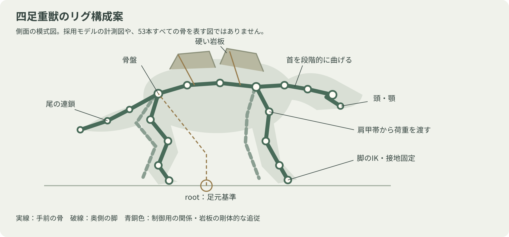
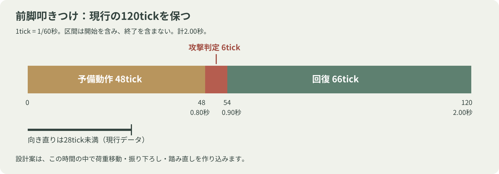

# Kari モンスターのモーション・ポリゴン・スケルトン設計提案 v1

霧境の狩人 - VEILBOUND HUNTERS / 2026-11-25

**対象ソース:** `kamamon/Kari` / v0.20.0 / `1d8e084d0d16fe77c376570f9542dd3c54fb5332`

**成果物の状態:** 設計提案。正式モデル・アニメーションクリップ・ゲームへの組み込みは今回の成果物に含まれない。本文の数値は、出典付きの現行値と「提案」と記した初期目標を区別する。

## 1. 結論と現在地

**既存の骨とスキニングを土台に、接地、体重移動、攻撃と部位判定の一致、種ごとの器官の動きを整える。ガルドロスとセルヴァルクを先行モデルにし、体型別に広げる。**

ポリゴンを一律に増やす前に、正面から見た幅、関節位置、硬い殻と柔らかい皮の境目を決める。モーションは「なぜその姿勢になるか」が見えるように、支える脚、力をためる部位、攻撃後の重さまで設計する。

### 確認できた現状

| 項目 | 基準コミットで確認したこと | 設計への意味 |
| --- | --- | --- |
| 登録数 | 図鑑86種。実装状態は20種（大型01〜12、幼体14〜21）、原画段階1種（13エンバルグ）、計画65種 | 全86種の完成モデルがあるとは扱わない |
| ガルドロス | 53本の骨、Skeleton / SkinnedMesh、足先保持と2ボーンIK、尾の遅れ、視線、局所被弾、岩板破砕がある | この資産を正式モデルへ移す |
| 他の大型11種・幼体8種 | 同じく骨・ウェイト付きの連続メッシュ。種ごとの背骨・脚・器官を手続き生成 | 骨をゼロから導入する段階ではない |
| 一般モンスターの歩行 | 移動距離で歩行周期を進め、脚の角度を周期的に変える。支持中の足先を固定するIKはない | 接地と体重移動の優先度が高い |
| 攻撃 | 技のtickに合わせた構え・攻撃・戻りがある。ガルドロスの一部は判定と同じ軌道を参照 | 時刻の同期と、空間上の一致を別々に検査する |
| 攻撃を受ける部位 | `monsterShapes()`は定義形状を本体位置と向きへ変換。頭・脚・尾のポーズには追従しない | 大きな首振りや転倒を作る前に、部位追従を設計する |
| 正式GLB | GLBの読み込み・AnimationMixerは素材ビューアにある。ゲーム本体は仮リグを使用 | MonsterRigの共通インターフェースから段階移行する |

根拠: [R1] [R2] [R3] [R4] [R5]。

### 先に解く具体的な問題

1. 一般リグの `jaw` 姿勢値が顎の骨へ適用されていない。噛む・吠える動作には、独立した顎、口腔、ウェイトを定義する。
2. キリサーヴの生態は短肢で這うとする一方、成体の `LegPlan` は空。固定板状の形はあるため、脚の外見が無いとは断定せず、可動脚としての構造を照合する。
3. チルミカナの幼燐節、ユルテピカの紡糸管は、生成された独立器官の形状データが各0件。コピー後の部品をコピー前のPython `id()`で選ぶ処理が原因として再現できる。絵に模様が描かれていることと、動かせる器官が存在することを分ける。

これらは修正候補としてClaudeへ渡す。今回、実装ファイルは変更していない。[R3] [R6] [R7]

## 2. 共通の設計規格

### 座標・大きさ・時間

- 現行規格の **m単位、Y上、+Z前、キャラクター右側が-X** を維持する。原点は接地面の中央。Blenderからの変換後に基準1m立方体と照合する。
- 図鑑上の全長とゲーム内の寸法を別欄にする。例としてガルドロスは登録簿8.5m、採用設定図の換算と現在のゲームモデルは約5.8m。図鑑の値をそのままGLBの倍率へ使わない。
- 動作は60Hzの固定tick。区間は開始を含み終了を含まない。`[48,54)`は48〜53tick。
- クリップはin-place。前進は既存controllerと移動曲線が担当する。GLBのroot移動を重ねて二重に前進させない。
- 攻撃時刻・移動距離・旋回終了・ヒットストップは既存データを正本とする。アニメーションの都合で黙って変更しない。

根拠: [R4] [R5] [R8]。以降の骨数・三角形数・許容誤差は、この規格の上で試す提案値である。

### 再利用するもの

骨の役割、足の接地状態、クリップの分類、判定基準点、破壊状態の受け渡しを共通化する。体型、脚の付き方、支持率、器官の曲がり方、攻撃の力の伝わり方は種ごとに持つ。同じ体型でも、骨長が違う個体へ角度をそのままコピーして完了とはしない。

## 3. 骨格をどう分けるか

登録簿の7骨格群は維持する。制作では多脚甲殻を「水平歩行」と「輪化」に分け、**7つの制作テンプレートと巨躯の別設計枠**を用意する。下表の骨数は、書き出す変形用骨とrootの目安で、DCCの操作用コントローラーやsocketは含めない。

| 制作テンプレート | 登録簿の群・数 | 主な対象 | 可動の核 | 骨数の初期目安（提案） |
| --- | --- | --- | --- | --- |
| 四足重獣 | 四足重獣20種 | ガルドロス、ヌメラドン、ボルナケル、エンバルグ | 胸と腰を分ける。支持脚、短い首、重い器官 | 48〜64。ガルドロスは既存53本から開始 |
| 四足軽獣 | 四足軽獣12種 | セルヴァルク、ヴェルガイト | 肩の前後移動、後脚の屈伸、着地時の吸収 | 44〜60 |
| 二足翼獣 | 二足翼獣13種 | アシュレイア、ルミスカ | 骨盤、二脚、長首、翼根・肘・翼端、尾 | 48〜68 |
| 六脚甲殻 | 六脚甲殻8種 | オルグラス | 歩脚6本と攻撃用の鋏を別制御 | 44〜64 |
| 水平多脚 | 多脚甲殻11種の一部 | ヴェリト | 脚の接地を順送り。袋・尾管は別器官 | 48〜72 |
| 輪化多脚 | 同じ11種の一部 | テンガロ | 体節を閉じる／開く。節の硬さと関節膜を分離 | 48〜72 |
| 長胴獣 | 長胴獣12種 | ラズメル、キリサーヴ | 体節の連続曲げと接地。短肢は独立制御 | 48〜72 |
| 巨躯の別設計枠 | 巨躯10種 | 後続の超大型 | 全身接地、カメラ、部位の攻略範囲を一体設計 | 代表種の構図確定後に決める |

数の集計は20+12+13+8+11+12+10=86。水平多脚と輪化多脚を二重計上しない。骨数は上限保証ではなく、器官が必要なら追加して計測する。[R1] [R6]

未実装65種の全てについて最終骨格を確定したわけではない。例えば三枝尾を持つシルハトラには、同じ二足翼テンプレートにも追加の分岐が要る。巨躯は通常個体を拡大するだけでは接地・移動・画面内の読みやすさを解決できない。

## 4. ガルドロスを基準にした骨・変形の設計

### 既存53本の骨を役割で整理する

| 役割 | 設計方針 | 注意点 |
| --- | --- | --- |
| rootと胴の基準 | 本体の位置・向きはcontroller、胸と腰は見た目の体重移動 | 地面への原点と胴の上下動を混同しない |
| 背骨・胸・骨盤 | 既存の胴各節を残し、前脚を上げる前の荷重移動を表現 | 胴全体を1つの箱のように回さない |
| 首・頭・顎 | 首の根元と先端、頭、下顎を独立。口の内側を用意 | 視線だけで頭の判定を大きく外さない |
| 前脚・後脚 | 既存の付け根・肘/膝・足首・指を利用。曲がる向きと可動限界を記録 | 脚を伸ばし切るときのIK反転を防ぐ |
| 尾8節 | 待機は遅れて追従、攻撃中は技の基準姿勢へ固定的に従う | 切断点と残る節を全LODで一致させる |
| 岩板15枚 | 各板を硬い部品として扱い、付け根だけ少し動かす | 岩板を皮膚のようにぐにゃりと曲げない |
| 表情・補助 | 瞼、舌、呼吸は既存を活用し、戦闘を邪魔しない範囲に抑える | 全器官を同時・同周期に揺らさない |

既存の骨は番号管理が中心なので、正式GLBには「現在の番号・役割」と「書き出す骨名」の対応表を付ける。`root`、`pelvis`、`chest`、`neck_01`、`head`、`jaw`、`tail_01`等は命名案であり、いま存在する正式名とは扱わない。[R2]

攻撃基準点は前脚の打撃面、口の先、尾の打撃部に置く。足裏・頭の破壊面・背殻・尾の切断面も位置を記録する。socketを置くだけでは判定は追従しないので、後述の60Hz評価経路を合わせて作る。

### 制作時の基準姿勢

四足は軽く曲げて接地した自然立ち、二足翼は翼を少し開いて膜が潰れない姿勢、甲殻は歩脚と鋏が重ならない姿勢、長胴は緩い直線を基準とする。操作用IKターゲット等は制作ファイルに残し、ゲームへ不要な制御骨は書き出さない。

柔らかい皮膚は関節へ複数骨の重みをなめらかに配り、硬い板は基本的に対応骨へ固定する。1頂点の影響を最大4本として正規化する初期方針を続ける。これはKariの予算方針であって、glTF全体の絶対上限とは言わない。[R2] [R3] [E1] [E3]

## 5. ポリゴン・UV・破壊部位

### ポリゴンを増やす場所

最優先は輪郭と関節である。肩、股、肘、膝、顎、首、尾の付け根、翼の折れ目に変形用の面を置く。肩の極端な曲げを、関節中央の一点へ集中する放射状の面だけで処理しない。曲げ前後に補助ループを置き、最大屈曲姿勢で潰れを確認する。

角、岩冠、背の大岩板、鋏、尾端塊のように影と輪郭が変わる部分は形状で作る。細かい鱗、浅い傷、細かな亀裂は画像の色・法線・粗さへ割り当てる。正面の模様まで横原画を引き伸ばす方式から、固有UVへ移す。ガルドロスの左右非対称の岩板は反転コピーで統一しない。[R3] [R8]

### 初期予算案

単位は**書き出し後の三角形数（tri）**。四角面の数ではない。頭、尾、殻、膜を含めた個体全体の値で、実測済みの現在値ではない。

| 対象 | LOD0: 近距離 | LOD1: 中距離 | LOD2: 遠距離 | 初期方針 |
| --- | --- | --- | --- | --- |
| 通常大型 | 12,000〜20,000 | 6,000〜10,000 | 2,000〜4,000 | 顔と攻撃器官を残す |
| ガルドロス等の殻が多い大型 | 16,000〜24,000 | 8,000〜12,000 | 3,000〜5,000 | 大きな板を優先、細傷は画像 |
| 幼体 | 4,000〜8,000 | 2,000〜4,000 | 800〜1,500 | 群れの同時表示を想定 |
| 巨躯 | 別計測 | 別計測 | 別計測 | カメラに占める面積と部位数から配分 |

初回は同じ骨格を保った形状LODで開始する。骨の削減は、判定基準点や切断位置の対応が壊れないことを確かめた後に扱う。LODの切替は距離だけでなく画面に占める大きさと戦闘参加を見て決め、往復切替を抑える幅を持たせる。

基本材質は皮・硬質部・必要な膜の2〜4区分を目安にする。ただし**材質区分数とdraw call数は同じではない**。サブメッシュ、破壊差分、影などの実描画回数を測る。既存の一般モンスターには同種の形状と画像の共有があるため、共有化済みの仕組みを保つ。[R3]

### 画像とメモリ

体の画像は1Kを基本候補とし、近距離で顔・殻が不足する場合に2Kを検討する。色、法線、粗さ等を全て同じ解像度にする必要はない。PNG/WebPファイルの小ささをGPUメモリの小ささと同一視しない。必要になればKTX2等のGPU圧縮を検証し、デコーダとロード経路を含めて評価する。[E4]

### 壊れ方

頭冠・背殻は「無傷」「壊れた外殻」「露出した下地」を用意し、外殻だけを切り替える。尾は切断面を閉じ、残る尾と落ちた尾を別に描く。切断後に攻撃範囲も短くなる既存分岐を維持する。一般リグの器官縮小・暗色化は仮表現として扱い、正式モデルでは部位ごとの破壊形へ移す。[R2] [R3] [R9]

## 6. 重さの伝わるモーション

### 共通の作り方

1. **支持を作る。** 動かす脚と支える脚を決め、先に胸・腰を支持側へ寄せる。
2. **力をためる。** 後脚の屈伸、首の折り畳み、嚢の膨らみなど、その体で攻撃できる理由を見せる。
3. **攻撃部位を動かす。** 胴から末端へ力が伝わる順を作り、打撃面と判定を一致させる。
4. **衝撃を受ける。** 足首・肩・胴が小さく沈む。硬い板は遅れて揺れ、すぐ収束する。
5. **立ち直る。** 足を戻してから通常姿勢へ戻る。この時間が狩人の反撃機会になる。

### 体型別の足運び

| 体型 | 歩行・旋回の設計 | 攻撃中の扱い |
| --- | --- | --- |
| 重四足 | 低速は支持時間を長くし、足を1本ずつ運ぶ。向き直りも踏み替える | 前脚を上げるなら残る3脚へ荷重。全身同時に上下させない |
| 軽四足 | 歩行と跳躍を分ける。後脚の蹴りと前脚の着地を明確に | 着地点を先に決め、体が着地してから脚が追いつく形を避ける |
| 二足翼 | 骨盤が支持脚上を移る。翼は釣り合いにも使う | 蹴る前に片脚支持、長首を伸ばす時は尾か骨盤で釣り合う |
| 六脚・多脚 | 支持する脚を残し、脚の上げ下げを順送り | 鋏や前脚を攻撃へ使う時は支持の組合せを変える |
| 長胴 | 接地している胴の区間を保ち、曲げを順に伝える | 支点と逃げ道が見えるよう、逆側へのためを作ってから払う |
| 輪化 | 歩く姿、輪へ閉じる姿、回転、開いて止まる姿を分ける | 回転中だけの都合で常時丸まった体にしない |

足IKの処理は、着地と離地の状態を決め、胸・腰の目標姿勢を作り、支持脚の足先を保持して関節を解き、指と器官を整える順にする。IKの届く範囲を越える場合は脚を伸ばして誤魔化さず、踏み替えか体側の補正を行う。

ガルドロスの接地処理も現状は各脚へ共通の地面高さを使う。将来の斜面では足ごとの高さと法線を取得する。ただしv0.20.0の高低差は未整備なので、この提案を現在の斜面対応済み機能とは扱わない。[R2] [R5]

### 動作数の考え方

最初は1体あたり概ね30〜40クリップを制作計画の目安にする。待機と警戒、歩行・走行・停止・旋回、採食・休息、咆哮、既存攻撃、局所怯み、転倒・起き上がり、罠、瀕死移動、討伐・捕獲を組み合わせる。左右差や切断後の違いは、必要なものだけ別クリップにする。

既存ガルドロスには23件の技定義と20種類の技clip名がある。咆哮・威嚇・退避・切断後の版も含むので、「23種類の攻撃」とは表現しない。新しい攻撃を増やす前に既存動作を磨く。[R9]

## 7. ガルドロスの攻撃を具体化する

### 前脚叩きつけ: 現行120tickを維持する例

既存の `monster.galdros.slam_l` / `slam_r` は、予備動作48tick、攻撃判定6tick、回復66tick。2.0秒の動作で、旋回は28tickより前だけ許可される。攻撃力や範囲を変更する提案ではない。[R9]

| 時間 | 現行の区分 | 動きの設計案 |
| --- | --- | --- |
| 0〜30tick | 予備動作の前半 | 支持側へ胸を寄せながら前脚を上げる。足が接地したまま回転して滑らないよう踏み替える |
| 30〜48tick | 予備動作の後半 | 前脚を高く保ち、どちら側を叩くか読める輪郭を作る。28tick以降は本体の照準追従を足さない |
| 48〜54tick | 攻撃判定 `[48,54)` | 既存の軌道に沿って振り下ろす。見える打撃面とカプセルを全tickで比べる |
| 54〜78tick | 回復の前半 | 前脚・肩が衝撃を受け、胸が沈む。背殻の揺れを短く残す |
| 78〜104tick | 回復の後半 | 肘を戻し、支持を4脚へ戻す |
| 104〜120tick | 回復の終端 | 呼吸と小さな尾の遅れだけを残して通常姿勢へつなぐ |

30、78、104tickは現在の前脚軌道にキーがある時点を利用した案であり、最終の関節角は動画と判定重ね表示で決める。active開始の48tickを必ず接地瞬間にする、と勝手に読み替えない。既存VFXは53tickなので、接触の演出も合わせて照合する。[R10]

### ほかの代表動作

| 技 | 現行の区分: 予備 / 判定 / 回復 | 強調する動き |
| --- | --- | --- |
| 突進 | `[0,60)` / `[60,132)` / `[132,190)` | 頭冠を下げる、掻く、後脚で押す、走行、減速して踏み直す。向き直りは既存の40tick未満 |
| 尾払い | `[0,40)` / `[40,58)` / `[58,110)` | 腰のため、尾根から先への加速、攻撃後の減衰。尾切断後も残る尾が動く |
| 噛みつき | `[0,40)` / `[40,47)` / `[47,96)` | 首を縮める、顎を開く、踏み込む、閉じる、頭を戻す |

怒り状態を作る時も、全クリップの一律高速化を前提にしない。強さの調整は既存データと切り分け、予兆が見える時間と攻撃後の隙を記録してから検討する。

## 8. 大型13種の固有設計

以下の身体特徴と技の題材は登録済みの設定を使い、動き方を提案している。原画の正式採用や新しい技の追加を意味しない。[R1] [R6]

| 種 | 骨格・器官で必要な点 | 重点モーションと見せ方 |
| --- | --- | --- |
| ガルドロス | 重四足、左右差のある大岩板、尾端塊 | 前脚叩きの前に3脚で支える。着地後は肩、背殻、尾の順で収束。岩板は硬さを保つ |
| セルヴァルク | 軽四足、後脚の深い屈伸、左右の分割角膜 | 横跳び蹴りは後脚を畳んでから弾く。着地脚を先に決める。風圧は角膜が開く姿で知らせる |
| ヌメラドン | 腹の低い重四足、泥皿、水圧嚢 | 泥皿を後ろへ傾けてから返す。腹滑りだけ支持を足から腹へ移し、停止後は前脚で起きる |
| ボルナケル | 重四足、頭鐘、独立した3つの嚢 | 音圧前に嚢を順に膨らませる。頭鐘の地面打ちは首と前脚が重さを受け、攻撃後に息を抜く |
| アシュレイア | 二足、長い首、短い帷翼 | 嘴突きは首をS字に畳んでから伸ばす。翼の骨と帷の遅れを分離。長時間の飛行は作らない |
| ルミスカ | 二足、長尾、燐節、翼 | 尾根から先へ点灯し、尾先と地面の関係で放電を見せる。尾払い後は先端が少し遅れて止まる |
| オルグラス | 歩脚6本、左右別寸法の鋏 | 横移動でも支持脚を残す。大鋏を開く前に胴を支え、閉じた後の引き戻しを見せる |
| テンガロ | 輪になる体節、外鉤、節間膜 | 開いた弧から閉じ、短距離だけ回転し、開いて止まる。硬い節をゴムのように曲げない |
| ヴェリト | 水平多脚、羽袋、紡糸管、前脚の糸櫛 | 接地を順送りする。袋を縮めて尾管を開き、前脚で糸を手繰る。羽袋を飛行翼へ変えない |
| ラズメル | 長胴、短肢2対、骨環 | 短肢で踏ん張り、逆側に曲げてから胴を薙ぐ。環の間が曲がり、骨環自体は硬く保つ |
| キリサーヴ | 長胴、左右交互の氷帆。短肢の構造は要照合 | 帆が順に立つ予告と氷片の発生を同期。胴の接地を残し、尾端を二段に曲げて叩く |
| ヴェルガイト | 軽四足、環冠、6つの灯節 | 静かな足運びと安定した頭。冠の傾き、灯節、霧球の順に見せ、セルヴァルクの弾む動きと区別 |
| エンバルグ | 重四足、胸腹の炉、背の排気弁 | 未実装の設計案。胸腹が膨らむ、該当側の弁が開く、熱息、排熱で沈む。ガルドロスの色違いにはしない |

## 9. 幼体と群れの設計

幼体は親の骨格規約を利用するが、単純縮小で仕上げない。頭・腹・脚・尾・器官の比率を個別に決め、成体の技を全部持たせない。既存生成器にも頭を大きくし、尾や飾りを縮める処理はあるので、原画に合うかを修正する段階である。[R6] [R7]

| 幼体 | 親 | 動きの差別化案 |
| --- | --- | --- |
| コルドピル | ガルドロス | 短い歩幅で根を探る。未発達な岩冠と尾端晶に合わせて小さく体を押す |
| パルセイト | セルヴァルク | 小刻みな警戒と短い跳び退き。未発達の角膜は大きく広げない |
| ヌマポロン | ヌメラドン | 低い泥皿を傾け、短い腹滑り後に前脚で起きる |
| チルミカナ | ルミスカ | 2つの幼燐節の点灯を読ませる。独立形状データの欠落を先に修正する |
| コハルギス | オルグラス | 小さな鋏と歩脚の役割を分け、左右への短い逃走を見せる |
| ミトガロン | テンガロ | 丸い鉤と柔らかい節。完全な輪になれない姿を保つ |
| ユルテピカ | ヴェリト | 平たい羽袋と短い糸。紡糸管の独立形状データの欠落を先に修正する |
| ヒナサルヴ | キリサーヴ | 丸い小さな氷帆と短肢を使い、成体より細かく歩く |

群れの個体は待機位相、瞬き、食むタイミングをずらす。戦闘と無関係な演出用乱数は既存の戦闘乱数列を消費しない。親子の行動や群れの役割は、既存herd状態を参照できる範囲から実装する。未実装の子育て・生態AIを完成扱いにしない。

## 10. 動きと当たり判定を一致させる構成

### 時間と位置を一本化する

「攻撃する形」「攻撃を受ける部位」「移動を押し戻す形」の3つを区別する。首が曲がるたびに本体の押し戻し円まで変形させる必要はない。

基本姿勢と基本軌道は、制作クリップまたは共通ポーズ解法からオフラインで生成する。地形IK、支持足の保持、歩行位相、怯み、姿勢遷移などはゲームの共通状態を入力として固定tickで評価する。動的な補正を含む全軌道を事前に焼けるとは扱わない。描画は評価済みの前後の姿勢を補間する。

最初の移行では、クリップから得た候補軌道を既存shapeTrackと比較し、クリップ側を合わせる。攻撃範囲が変わる再生成軌道を採用する場合は、別のゲーム仕様変更として記録し、戦闘検証する。体を良く見せるために既存の当たり範囲まで無断で広げない。

1. `actionId`とローカルtick、移動・怯み等の状態、支持足と歩行位相、地面の高さを使い、基準となる姿勢を固定tickで得る。停止・遷移時の状態も保持する。
2. 同じ基準姿勢から、爪・顎・鋏・尾などの攻撃軌道と、頭・胴・脚・尾の被攻撃形状を求める。
3. ゲームは固定tickで判定する。描画は前後tickを補間する。
4. ヒットストップ中は攻撃姿勢も止める。効果音・VFXの発火はゲームのイベントを使い、描画フレームで重複発火させない。
5. 地面へのIKや二次揺れが攻撃部位を変える場合は、共有の姿勢評価へ入れる。描画だけに大きな補正を加えない。

描画済みの `Bone.matrixWorld` をそのまま戦闘の正本へ読み戻す構成は採らない。30fps描画と60fps描画で判定が変わらないよう、ゲーム側の固定tickを守る。GLBのAnimationMixerもゲーム時刻から評価するアダプターを通し、壁時計だけで攻撃を進めない。[R4] [R11] [E2]

### 切り替えと割込み

通常は待機・移動から予備動作、攻撃、回復へ進む。予備から攻撃の境目は技データを優先する。怯み、転倒、罠、死亡・捕獲への割込みもゲームの状態を正本にする。死亡・捕獲が確定した後に、クリップの終了通知だけで攻撃へ復帰させない。

通常の姿勢ブレンドは6〜10tick程度を初期候補とするが、攻撃のactive区間を大きく混ぜて判定位置をぼかさない。攻撃基準点の許容誤差を越える場合は、ブレンドを短くするか、遷移専用の姿勢を用意する。値は実装時に調整する。

## 11. 実装順序と受け入れ条件

### 小さく採用する順番

| 順序 | 作業 | 完了したと判断する材料 |
| --- | --- | --- |
| P0 | 顎の可動経路、幼体2種の器官欠落、キリサーヴの可動脚、図鑑長とゲーム寸法の照合 | 意図した部品と骨が一覧になり、設定との差が説明できる |
| P1 | ガルドロスの歩行・旋回・前脚叩き・尾払いで、骨名と判定基準点の規約を作る | 固定tickで攻撃と部位形状が一致し、足滑りを数値と動画で確認できる |
| P2 | セルヴァルクを正式化し、軽四足の跳躍・着地・角膜を完成させる | 重四足と軽四足が、輪郭だけでなく動きでも区別できる |
| P3 | オルグラス、アシュレイア、ラズメル、テンガロ、ヴェリトの順に別体型へ展開 | 鋏、翼、長胴、輪化、多脚の支持方法がそれぞれ成立する |
| P4 | 同じテンプレートの残り、幼体、エンバルグへ展開。巨躯は別企画として着手 | 共通化した部分と種固有の追加が追跡できる |

順序は今回の推奨。採用済みのガルドロス以外の最終外見は、原画の採用と多方向資料で決める。セルヴァルクは同じ風礫盆地で比較しやすく、軽四足の支持・着地の検証にも使える。

### 正式モデル1体の納品単位

- 正面・背面・左右の設定図。上面の幅と器官付け根の補助図。ガルドロスは左側面の斜め具合と破壊後の図を補う。
- 編集元の制作ファイル、GLB、LOD、画像、骨名対応表。部品・材質・三角形・頂点・骨の数を記載。
- 既存のclip名、長さ、接地区間、攻撃基準点、破壊・切断後の対応表。
- 軌道の生成元と生成手順。生成物のJSONやTypeScriptだけを手直しせず、既存の生成器へ反映する。
- 正面・側面・斜め後ろの通常速と0.25倍速動画、判定を重ねた動画、実機の計測結果。

### 合格基準案

| 分類 | 初期の受け入れ条件（提案） |
| --- | --- |
| 単位・向き | m、Y上、+Z前、基準サイズ、原点、左右が一致。名前の欠落を似た名前で代用しない |
| 足の接地 | 平地の低速支持区間で足先の滑りを原則2cm以内に抑える。滑走・蹴り出し・転倒は明示した例外 |
| 攻撃の一致 | active全tickで、攻撃socketと生成軌道の対応点を2cm以内。巨大種・特殊攻撃は個別に決める。カプセルは設計上の太さを持つため、表面の完全一致という意味ではない |
| 被攻撃部位 | 待機・攻撃・怯み・転倒・破壊後の部位が見える位置を追う。弱点と判定が別の場所に残らない |
| フレーム非依存 | 同じ入力で30/60fps描画の戦闘結果が一致。ヒットストップ、割込み、尾切断、当たりの多重処理を確認 |
| 形状 | 最大屈曲で関節の反転・大きな潰れ・硬い殻の変形・膜の裏返りがない |
| 表示 | 最大姿勢を含む境界を用意し、画面端やLOD切替で体・尾・灯節が消えない |
| 実機 | iPhone Safariで、近接戦、大型と幼体の同時表示、破壊直後を計測。30fps目標なら33.3msの描画間隔を基準に平均・p95・100ms超の回数を報告 |

数値は正式な性能保証ではない。ポリゴン数だけで合格にせず、通常速の見た目と実機の負荷で決める。遠距離の非戦闘個体の描画更新を間引く場合も、シミュレーションの60Hzや攻撃時刻は変えない。

## 12. 今回の検証・未確定事項

### 確認したこと

- 基準コミットのAGENTS.md、掲示板、引継ぎ、アニメーション規格、登録簿、リグ、技と軌道、生成器、関連テストを読み取り確認した。
- 登録簿の件数、状態、骨格群を機械集計した。23件のガルドロス技定義と20のclip名を抽出した。
- 幼体2種の独立器官データ0件を、`runpy.run_path`で生成器のmainを呼ばずに再現した。
- Node.js v24.22.3で `npm ci --ignore-scripts --no-audit --no-fund --offline` を実行し、依存50パッケージの導入が成功した。取得したソースの作業コピーで行った依存導入であり、ゲームのビルドや全テストの通過とは別である。
- 今回は図鑑の設定を変更するJSONを作っていないため、`bestiary:import --dry`の対象はない。附属の監査表は読み取り結果であり、インポート用データではない。

### 守れなかった決まり・迷って決めたこと

- 今回は掲示板番号の無い利用者からの直接依頼のため、提出先に仮の識別子 `user-20261125-monster-motion` を用いる。既存の番号付き依頼へ混ぜない。
- 書き込みは `chatgpt-inbox/` 内の設計文書と監査表に限定する。コード、公開データ、設定図、掲示板の更新はClaude側の作業として具体的な候補を示した。
- 決定済みの原画を新しい絵柄へ置き換える提案はしていない。骨数、LOD予算、許容誤差、実装順は今回の判断で置いた初期提案値。

### 未確認

通常速度のゲーム動画、実機iPhoneでの動きと性能、各個体の現在の実三角形数、全攻撃の軌道誤差、正式GLBの変形、原画の未承認部分は確認していない。足滑り等の起こり得る症状はコード構造からの指摘であり、全種の実動画で観察済みという意味ではない。

## 参照元

リポジトリの参照はすべて基準コミットへ固定した。技術資料は2026-11-25に確認した一次資料。

- [R1] [登録簿: public/data/bestiary.json](https://github.com/kamamon/Kari/blob/1d8e084d0d16fe77c376570f9542dd3c54fb5332/public/data/bestiary.json)
- [R2] [ガルドロスのリグ: src/render/galdrosRig.ts](https://github.com/kamamon/Kari/blob/1d8e084d0d16fe77c376570f9542dd3c54fb5332/src/render/galdrosRig.ts)
- [R3] [一般リグ: src/render/creatureRig.ts](https://github.com/kamamon/Kari/blob/1d8e084d0d16fe77c376570f9542dd3c54fb5332/src/render/creatureRig.ts)
- [R4] [アニメーション規格](https://github.com/kamamon/Kari/blob/1d8e084d0d16fe77c376570f9542dd3c54fb5332/docs/animation-contract.md)
- [R5] [引き継ぎ: docs/handoff.md](https://github.com/kamamon/Kari/blob/1d8e084d0d16fe77c376570f9542dd3c54fb5332/docs/handoff.md)
- [R6] [体型・技の設計データ: src/render/creaturePlans.ts](https://github.com/kamamon/Kari/blob/1d8e084d0d16fe77c376570f9542dd3c54fb5332/src/render/creaturePlans.ts)
- [R7] [モンスター生成器: tools/gen-monsters.py](https://github.com/kamamon/Kari/blob/1d8e084d0d16fe77c376570f9542dd3c54fb5332/tools/gen-monsters.py)
- [R8] [ガルドロスの採用設定図と寸法](https://github.com/kamamon/Kari/blob/1d8e084d0d16fe77c376570f9542dd3c54fb5332/art-source/monster/galdros/galdros_turnaround_v1.md)
- [R9] [ガルドロス基本技](https://github.com/kamamon/Kari/blob/1d8e084d0d16fe77c376570f9542dd3c54fb5332/public/data/actions/galdros.json) / [拡張技](https://github.com/kamamon/Kari/blob/1d8e084d0d16fe77c376570f9542dd3c54fb5332/public/data/actions/galdros_ext.json)
- [R10] [ガルドロスの基本軌道](https://github.com/kamamon/Kari/blob/1d8e084d0d16fe77c376570f9542dd3c54fb5332/public/data/tracks/galdros.json)
- [R11] [モンスター状態と部位判定: src/game/monster.ts](https://github.com/kamamon/Kari/blob/1d8e084d0d16fe77c376570f9542dd3c54fb5332/src/game/monster.ts)
- [E1] [Three.js SkinnedMesh](https://threejs.org/docs/pages/SkinnedMesh.html)
- [E2] [Three.js AnimationMixer](https://threejs.org/docs/pages/AnimationMixer.html)
- [E3] [Khronos glTF 2.0 specification](https://registry.khronos.org/glTF/specs/2.0/glTF-2.0.html)
- [E4] [Three.js GLTFLoader](https://threejs.org/docs/pages/GLTFLoader.html)
